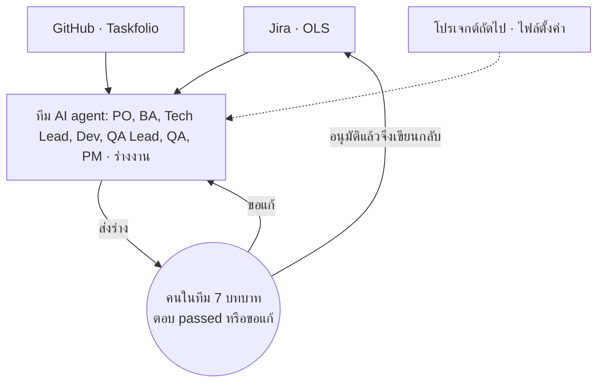
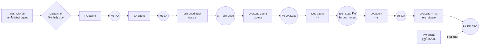

# แผนทีม AI Agent: รับงานจากหลายโปรเจกต์ใน Jira และ GitHub ร่วมกับ 7 ฝ่าย

> **สถานะ:** ร่างเพื่อคุยกับทีมก่อนเริ่มพัฒนา (draft for team review) · ยังไม่เริ่มสร้างตามแผนนี้ · เจ้าของแผน: @Thitic9203 ·
> ปรับครั้งล่าสุด (รอบสอง: รีวิวด้วยสกิล agent-designer แล้วเติมสถาปัตยกรรม สัญญาส่งต่อ เครื่องมือ สิทธิ์ งบ การวัดผล)
>
> **ที่มา:** เจ้าของ "ปรับแพลนในเรโป ต้องการโฟกัสการทำงาน AI Agent ที่รองรับงานจากหลายโปรเจ็คใน Jira, GitHub โดยผู้ร่วมงานจะมีหลายฝ่าย
> เช่น PO BA Tech Lead Dev QA Lead QA PM ... ปรับแพลนมาก่อน ยังไม่ต้องเริ่มทำ เราต้องเอาแพลนไปคุยกับทีม" · รอบสอง: "รีวิวและใส่รายละเอียดในแพลนให้ครบถ้วน
> พร้อมที่จะนำไปคุยกับทีมเพื่อเริ่มพัฒนา"
>
> **แผนนี้แทนอะไร:** เป็นแผนหลักของทิศทางใหม่ แผนเดิมยังเป็นบันทึกสิ่งที่สร้างแล้ว:
> [always-on-dev-agent](../superpowers/plans/always-on-dev-agent.md) (ตัว agent ฝั่ง GitHub ของ Taskfolio),
> [agent-workflow-and-economy](../superpowers/plans/agent-workflow-and-economy.md) (บทบาท สกิล รอบ release),
> แมพ [multi-project-intake](../wayfinder/multi-project-intake/MAP.md) (งาน QA ของ OLS) และแมพ
> [agent-all-roles](https://github.com/Thitic9203/pluton-timesheet/blob/main/docs/wayfinder/agent-all-roles/MAP.md) (PO/BA, DEV, QA จาก Jira)
>
> **ไฟล์ออกแบบ (สร้างด้วยเครื่องมือของสกิล agent-designer):** [agent-team-design/](agent-team-design/) มี `requirements.json` (ความต้องการที่ป้อน),
> `arch.json` (ผลวิเคราะห์สถาปัตยกรรม), `tool_descriptions.json` และ `tools_anthropic.json` (สคีมาเครื่องมือ 6 ตัว), `tools_validation.json` (ผลตรวจ:
> ทั้ง 6 ตัว `✓ Valid`)

---

## 0. ที่มาและความสำคัญ

> **หน้าสำหรับคุยกับทีม (มีภาพรวมและกระบวนการเป็นภาพ):** [แผนทีม AI Agent](https://claude.ai/artifact/9tWDnQzdMpv2QgBmWqq3qd)

### สรุปสำหรับหัวหน้า

<!-- summary:start -->
| เรื่อง | สรุป |
| :--- | :--- |
| ปัญหา | งานร่างที่ซ้ำ (AC, เทสเคส, test plan, สรุปสถานะ) กระจายอยู่ใน Jira และ GitHub หลายโปรเจกต์ คนทำเองทุกใบ |
| สิ่งที่ขออนุมัติ | เริ่ม pilot ขั้น 1 ถึง 8 กับ OLS และ Taskfolio · ให้ Claude รันวันละ 8 ชั่วโมง · ทีมใช้เวลารีวิวรวมประมาณ 73 ชั่วโมงตลอดแผน (ข้อ 11a) |
| ระยะเวลา | 48 วันทำการถึงจบ pilot (26 Oct 2026 ถึง 5 Jan 2027) · รวมโปรเจกต์ที่สาม 54 วันทำการ (ถึง 13 Jan 2027) |
| ค่าใช้จ่าย | $0 นอกบัญชี Claude Max เดิม · มีเงื่อนไข: โควตา Actions ของ org (Q5) และเงื่อนไขของบัญชี Max (Q14) |
| ความเสี่ยงหลัก | ข้อมูลลูกค้าออกนอก VPN (Q15) · คนไม่ตอบแล้วงานค้าง (Q17) · บัญชี Max ชนเพดานการใช้งาน (ข้อ 14 W1) |
| เกณฑ์ผ่าน | ทุกบทบาทเดินครบอย่างน้อย 1 ใบ และตัววัดข้อ 9 ผ่าน |
| เกณฑ์หยุดทันที | มีการเขียนกลับโดยไม่มี `passed` · พบปัญหาวิกฤตจาก evaluator · มีค่าใช้จ่ายใหม่ · เกณฑ์อื่น เช่น อัตราร่างที่ต้องแก้ ตั้งหลังวัด 2 สัปดาห์แรก (judgment) |
| หยุดหรือถอนตัว | เอา label `agent` ออก งานนั้นไม่ถูกรับ (ข้อ 2) · ปิด flag ของโปรเจกต์ agent หยุดทั้งโปรเจกต์ |
| ผู้รับผิดชอบ | เจ้าของแผน @Thitic9203 (ระบบและโค้ดของ agent) · คนอนุมัติต่อบทบาทต่อโปรเจกต์ตาม Q2 |
<!-- summary:end -->

**ที่มา:** งานของทีมกระจายอยู่หลายที่ ทั้ง ticket ใน Jira (เช่น OLS) และ issue ใน GitHub (เช่น Taskfolio) · งานร่างหลายอย่างทำซ้ำทุกใบ
เช่น เขียน AC, เทสเคส, test plan และสรุปสถานะ · ตัวอย่าง: OLS มี story ที่รอเติมรายละเอียดจาก PO/BA 6 ใบ (แมพ agent-all-roles A1)

**ความสำคัญ:**

- งานร่างที่ซ้ำ agent ทำให้เองทุกวันโดยไม่ต้องสั่ง คนเหลือแค่ตรวจและตัดสิน
- ทุกโปรเจกต์ทุกบทบาทใช้ทางเดียวกัน เพิ่มโปรเจกต์ใหม่ได้ด้วยไฟล์ตั้งค่าหนึ่งไฟล์
- ไม่มีอะไรเขียนลงระบบของทีมโดยไม่ผ่านคน และไม่มีค่าใช้จ่ายใหม่



## 1. เป้าหมาย (สิ่งที่ทีมจะได้)

1. ทีม agent รับงานเองจากหลายโปรเจกต์ ทั้ง **Jira** (เริ่มที่ OLS) และ **GitHub issue** (เริ่มที่ pluton-timesheet) โดยไม่ต้องมีคนสั่งทีละงาน
2. agent มี **7 บทบาท** คู่กับคนจริงในทีม: PO, BA, Tech Lead, Dev, QA Lead, QA, PM · agent ทำงานร่าง คนในบทบาทนั้นเป็นผู้ตัดสิน
3. ทุกการเขียนกลับระบบของทีม (Jira, GitHub, Sheet) **ผ่านการอนุมัติของคน** ก่อนเสมอ
4. เพิ่มโปรเจกต์ใหม่ได้ด้วย **ไฟล์ตั้งค่าหนึ่งไฟล์** ไม่ต้องแก้โค้ด
5. ไม่มีค่าใช้จ่ายใหม่ ถ้าไม่ได้อนุมัติเป็นรายกรณี (กฎ global ข้อ 3)

**นอกขอบเขต:** agent ข้ามหรือลดจุดอนุมัติของคน · agent deploy production เอง · agent merge เข้า `main` ของ repo ใดก็ตาม (ใน Taskfolio
agent merge ได้แค่ `release/next` หลังคน Tech Lead อนุมัติ ตามแผน always-on)

## 2. หลักการที่ไม่เปลี่ยน (ตัดสินแล้ว ไม่ต้องคุยซ้ำ)

| หลัก | ที่มา |
| :--- | :--- |
| agent **เริ่มงานเอง** ทุกวัน คนไม่ต้องสั่ง | เจ้าของ "Agent ทำเองอัตโนมัติทุกวัน ทุกครั้งไม่ต้องให้บอกนะ" |
| **จุดอนุมัติคงเดิม**: agent ร่าง คนอนุมัติ ก่อนเขียนกลับ | เจ้าของ popup "คงจุดอนุมัติเดิม" |
| agent รับเฉพาะงานที่ **ติด label `agent`** (Jira) หรือ `agent:ready` (GitHub) | A4, A5 ของแมพ agent-all-roles · Decisions Q1 ของแผน always-on |
| agent ไม่ deploy production เอง | แผน always-on "ไม่ทำใน pilot" |
| สเปกก่อนโค้ดทุกครั้ง (spec, plan, tasks) | CLAUDE.md hard constraint 22 |
| งาน Jira รันบน GitHub Actions ใน repo นี้ ยกเว้นขั้นที่ต้องเปิดเว็บใน VPN ของลูกค้า (รันบน Mac runner `ols-e2e`) | A3, A7 ของแมพ agent-all-roles |
| โค้ดของ agent อยู่ใน `pluton-ai-agent` แยกจากโค้ดของ product | เจ้าของ, spec [repo-split](../sdd/repo-split/spec.md) |
| การประเมินขนาดงานทำร่วมกันทุกบทบาท ไม่ใช่ฝ่ายเดียว | เจ้าของ popup (A4) |

## 3. สถาปัตยกรรม

### 3.1 รูปแบบ: Supervisor ที่เป็นโค้ด + ขั้นตอนตามบทบาท

ป้อนความต้องการของแผนนี้ ([requirements.json](agent-team-design/requirements.json)) เข้า `agent_planner.py` ของสกิล agent-designer ได้รูปแบบ
`SUPERVISOR` ([arch.json](agent-team-design/arch.json)) ตรงกับที่ระบบเดิมใช้อยู่ (แผน always-on "ตรวจสถาปัตยกรรม 14 Oct": dispatcher เป็นผู้คุม)

- **Supervisor = dispatcher ที่เป็นโค้ดล้วน ไม่ใช่ LLM:** อ่านสถานะของงานจาก label และประวัติคอมเมนต์ แล้วเลือกว่าขั้นถัดไปคือบทบาทไหน ·
  จุดที่เครื่องมือเตือนว่า "ผู้คุมเป็นคอขวด" ไม่เกิด เพราะ dispatcher ไม่เรียกโมเดล
- **แต่ละบทบาท = agent หนึ่งตัวที่รันเป็นงานแยก** (หนึ่ง job ต่อหนึ่งขั้น) ได้ context ใหม่ทุกครั้ง อ่านเฉพาะสิ่งที่ขั้นก่อนส่งมา
- **คนอยู่ระหว่างทุกขั้น:** agent ส่งร่าง แล้วรอ `passed` จากคนในบทบาทนั้นก่อน dispatcher จะเปิดขั้นถัดไป
- **ปรับจากผลของเครื่องมือ:** เครื่องมือเสนอ agent 3 ตัว (supervisor 1 ตัว + specialist 2 ตัว: development, communication) แผนนี้แยกเป็น 7 บทบาทตามคนจริงในทีม เพราะคนอนุมัติ
  ต่างกันในแต่ละขั้น (judgment) · ที่เครื่องมือเสนอแต่ตั้งใจไม่ทำ: retry แบบ backoff อัตโนมัติ (ขัดกฎ global ข้อ 21 ที่ให้หาเหตุ ไม่ rerun) · กฎข้อ 21 พูดถึงเทสต์ที่ผลไม่คงที่ ส่วน error ชั่วคราวของ
  Jira หรือ Slack (เช่น 429, 503) จะ retry แบบจำกัดจำนวนได้ไหม เป็นคำถาม Q16



### 3.2 ชั้นของระบบ

| ชั้น | ทำอะไร | อยู่ที่ไหน |
| :--- | :--- | :--- |
| ตัวรับงาน (intake) | อ่านงานที่ติด label จากทุกโปรเจกต์ตามไฟล์ตั้งค่า | GitHub Actions ตามตาราง + event จาก relay ของ pluton-timesheet |
| Dispatcher | ตัดสินขั้นถัดไป, เพดานงานพร้อมกัน, คิว | โค้ดใน `pluton-ai-agent` (`scripts/agent/dispatch.mjs` ต่อยอด) |
| Role agents | ร่างงานของแต่ละบทบาท | `claude-code-action` บน GitHub Actions / Mac runner สำหรับงานใน VPN |
| ประตูอนุมัติ | ส่งร่าง, อ่านคำตอบ `passed` | Slack DM (Jira) / คอมเมนต์ GitHub (Taskfolio) |
| ตัวเขียนกลับ | เขียนเฉพาะสิ่งที่อนุมัติ แล้วอ่านกลับตรวจ | โค้ดล้วน (ไม่ใช่ LLM) |
| การมองเห็น | สถานะ, เวลา, ค่าใช้จ่าย | Agent Office + สรุปของ PM agent |

## 3a. อ้างอิงหลักการ ADLC: agent ลงมือ คนอนุมัติ

ที่มา: เจ้าของ ส่งภาพ "SDLC vs ADLC" ของ Limestone Digital (2026) "เอาฝั่งขวามือ มาใช้ในแผนอย่างไรได้บ้าง ... บอกด้วยว่า อ้างอิงหลักการนี้ๆ"
· ADLC (Agentic Development Lifecycle) = วงจรเดิม แต่ agent ลงมือ และคนอนุมัติที่ประตู · หลักสำคัญในภาพ: "Agents implement. Engineers
approve." และ "Architecture stays with engineers."

| ขั้น ADLC | ใครทำ | ในแผนเราคือ | สิ่งที่ปรับตามหลักการนี้ |
| :--- | :--- | :--- | :--- |
| 01 Define the task | คน | PO/BA ร่าง แล้วคนอนุมัติ | แพ็กเกจต้องมี **ขอบเขต (bounds)**: ส่วนที่แตะได้ สิ่งที่ห้ามแตะ งบเวลา |
| 02 Agent proposes plan | agent | Tech Lead agent: ไฟล์ แนวทาง ความเสี่ยง | คงเดิม |
| 03 Engineer approves plan | ประตู | Gate 1 คน Tech Lead ตอบ `passed` | Dev เริ่มไม่ได้จนกว่ามีคำอนุมัติชัดเจน (dispatcher บังคับ) |
| 04 Agent implements | agent | Dev agent บน branch `agent/<key>` | ทำใน **sandbox ที่แยกและจำกัดสิทธิ์**: runner ของ GitHub ไม่ใช่เครื่องคน, token เฉพาะ repo นั้น |
| 05 Agent runs checks | agent | Dev รันเทสต์ · QA ใช้สกิล Helix | **แก้จนเทสต์และ CI เขียวก่อนเปิด PR** (เดิมเปิด PR แล้วรอ CI) |
| 06 Engineer approves PR | ประตู | Gate 3: Tech Lead รีวิว ทีม dev merge | คงเดิม · ไม่มีอะไร merge โดยไม่ผ่านคนรีวิว |
| 07 Release & learn | ร่วมกัน | QA Lead + PM สรุปรอบ release | เพิ่ม **วงเรียนรู้**: agent ร่างบทเรียนหลังรอบ คนอนุมัติก่อนกลายเป็นกฎของรอบถัดไป |

**ดีอย่างไร** (การประเมินของแผนนี้ = judgment ยืนยันด้วยตัวเลขจาก pilot ในข้อ 9):

- **จับทิศผิดก่อนเสียเวลา:** คนอนุมัติแผนก่อน agent เขียนโค้ด แนวทางผิดแก้ได้ตั้งแต่ร่าง (ขั้น 02 ถึง 03)
- **คนรีวิวเฉพาะงานที่พร้อม:** agent แก้จนเทสต์และ CI เขียวก่อนเปิด PR เวลาของคนรีวิวใช้กับเนื้องาน (ขั้น 05)
- **ความผิดพลาดไม่หลุดเข้าระบบ:** ไม่มีอะไรเริ่มก่อนแผนอนุมัติ ไม่มีอะไร merge ก่อนคนรีวิว ทำใน sandbox จำกัดสิทธิ์ (ขั้น 03, 04, 06)
- **คนทำงานที่ต้องใช้คน:** agent รับงานประจำที่ซ้ำ คนเก็บเวลาไว้กับการออกแบบและการตัดสิน
- **ดีขึ้นทุกรอบ:** บทเรียนที่คนอนุมัติกลายเป็นกฎของรอบถัดไป ไม่พลาดซ้ำ ไม่ถามซ้ำ (ขั้น 07)
- **ตรวจย้อนได้:** ทุกประตูมีบันทึกว่าใครอนุมัติอะไรเมื่อไร

**ขอบเขตงานตามหลักการนี้:**

- **งานที่เริ่มให้ agent ทำก่อน:** งานประจำ คือ อัปเกรด dependency, แพตช์ความปลอดภัย, เพิ่มเทสต์, แก้บัค (Q12)
- **งานที่คงไว้กับคน:** การออกแบบสถาปัตยกรรม และงานขนาด XL agent ร่างได้ แต่คน Tech Lead เป็นผู้ออกแบบและตัดสิน
- **"Approved rules inform next run":** บทเรียนที่คนอนุมัติ เก็บในสมุดบทเรียนต่อโปรเจกต์ agent ทุกตัวอ่านก่อนเริ่มงานรอบถัดไป

## 4. บทบาท: agent ทำอะไร คนตัดสินอะไร

แต่ละบทบาทมี agent หนึ่งตัวต่อโปรเจกต์ (หรือมากกว่าเมื่อเพดานอนุญาต) และมี **คนในบทบาทนั้น** เป็นผู้อนุมัติ

| บทบาท | agent รับงานจาก | agent ทำ (ร่าง) | คนในบทบาทตัดสิน | ส่งต่อให้ |
| :--- | :--- | :--- | :--- | :--- |
| **PO** | งานใหม่ที่ติด label `agent` | จัดลำดับ backlog, ร่างเป้าหมายและ AC ระดับผลลัพธ์, ตอบคำถามขอบเขต | ลำดับงาน, ขอบเขต, ยอมรับผลรอบ release | BA |
| **BA** | งานที่ PO ส่งต่อ / Jira `Ticket Detail Status` = Pending Details, Pending PO Review, Awaiting PO Clarification | ร่าง AC ละเอียด, flow, กฎธุรกิจ, edge case, ลิสต์คำถามที่ไม่มีแหล่ง, เสนอ `Ticket Detail Status` ใหม่ | AC ครบหรือยัง | Tech Lead, Dev, QA Lead |
| **Tech Lead** | งานที่ AC ครบ / PR ที่เปิดใหม่ | ร่างแนวทางเทคนิคและความเสี่ยง, แตก subtask, รีวิว PR ด้วย `code-review` | แนวทางเทคนิค (Gate 1), อนุมัติ PR | Dev, QA Lead |
| **Dev** | งานที่ผ่าน Gate 1 และ Gate 2 | เขียนโค้ด test-first บน branch `agent/...` แล้วเปิด PR | (ไม่ตัดสินเอง) | Tech Lead |
| **QA Lead** | plan ที่ผ่าน Gate 1 / รอบ release | ร่าง test plan ผูก AC ทุกข้อ, รีวิวเทสเคสด้วย `tc-review`, สรุปผลรอบ release | test plan (Gate 2), ผ่านหรือไม่ผ่านของรอบ | QA, PM |
| **QA** | ใบ READY TO TEST / TESTING ที่ตัวเองเป็น QA Owner | เขียนเทสเคส, เทสด้วย `testing-ticket`, รีเทสด้วย `retest-bug`, ร่างผล | ผลเทส (`passed` ใน DM ก่อนเขียนกลับ) | QA Lead |
| **PM** | ภาพรวมทุกโปรเจกต์ (ไม่รับงานรายใบ) | ร่างสรุปสถานะรายวัน/รายสัปดาห์, ชี้งานที่ค้างนานหรือเสี่ยงเลยกำหนด, ร่างแผนรอบ release, ติดตามโควตาและค่าใช้จ่าย AI | ลำดับความสำคัญข้ามโปรเจกต์, วันที่ release | ทุกบทบาท |

> **PM เป็นบทบาทใหม่** ที่ยังไม่มีในแผนเดิม (เดิมมี "Head" ทำหน้าที่ใกล้เคียง) · หน้าที่ในตารางเป็น **ร่างให้ทีมคุย** (คำถาม Q1)

### 4.0 งาน QA: ใช้สกิล Helix ทุกด่าน คน QA อนุมัติสูงสุด

เจ้าของ: "อยากให้เพิ่มในส่วนงาน QA ให้ครบว่าใช้สกิลทดสอบจาก helix ที่เราทำไว้ทั้งหมดในทุกขั้นตอน ... คือใช้ AI สกิลจาก Helix ทำเสมอ
แต่ก็ยังต้องมี คนคือ QA เป็นผู้อนุมัติสูงสุดในแต่ละด่าน"

| ด่าน | สกิล Helix | agent ทำ (ร่าง) | คน QA อนุมัติ |
| :--- | :--- | :--- | :--- |
| เตรียมข้อมูลทดสอบ | `/test-data-prep` | สร้างข้อมูลที่เคสต้องใช้บน environment ทดสอบ และบันทึก id | ข้อมูลถูกต้องและพอสำหรับเคส |
| ทำเทสเคส | `/tc-fe-prep` · `/tc-api-prep` | เขียนเทสเคสหน้าเว็บและ API จาก AC ทุกข้อ ลงชีท QA | เทสเคสครบตาม AC |
| รีวิวเทสเคส | `/tc-review` | ตรวจเทสเคสเทียบ AC, edge case, กฎธุรกิจ | เทสเคสพร้อมใช้เทส |
| เทส story และ task | `/testing-ticket` | เทสด้วย Playwright เทียบ design และร่างผลต่อเคส | ผลเทสก่อนเขียนกลับ Jira |
| รีเทส bug และ task | `/retest-bug` | รีเทสหลัง dev แก้ เก็บหลักฐาน ร่างคอมเมนต์และสถานะ | ผลรีเทสและสถานะใหม่ |
| เปิดบัค | `/create-bug` | ร่างบัคพร้อมหลักฐาน เฉพาะเมื่อผลต่างจากสเปกที่ยืนยันแล้ว (กฎ global ข้อ 10) ถ้าสเปกไม่ชัดเป็นคำถามถึง PO | บัคนี้เป็นบัคจริงและเปิดได้ |
| รีวิวผลการเทส | `/review-result` | ตรวจหลักฐานและผลที่บันทึกว่าครบและสอดคล้อง | ผลเทสพร้อมส่ง QA Lead |
| smoke หลัง deploy | `/smoke-test` | เทสฟีเจอร์หลักหลังขึ้นแต่ละ environment แล้วสรุปผล | build นี้ไปต่อได้ |
| ตรวจงานตัวเองก่อนรายงาน | `/catch-ai` | ตรวจว่าทุกข้อที่รายงานมีแหล่งยืนยัน | (ทำก่อนส่งทุกร่าง) |

ลำดับปกติของใบหนึ่ง: เตรียมข้อมูล → ทำเทสเคส → รีวิวเทสเคส → เทส (story/task) หรือรีเทส (bug/task) → เปิดบัคถ้ามี → รีวิวผล → ส่ง QA Lead ·
ทุกลูกศรคือจุดที่คน QA ตอบ `passed` หรือขอแก้ · agent ไม่ทำงาน QA นอกสกิล Helix

### 4.1 RACI ต่อขั้น (R = agent ทำ, A = คนอนุมัติ, C = ถูกปรึกษา, I = ได้รับแจ้ง)

| ขั้น | PO | BA | Tech Lead | Dev | QA Lead | QA | PM |
| :--- | :---: | :---: | :---: | :---: | :---: | :---: | :---: |
| คัดเข้า backlog และจัดลำดับ | R/A | C | C | I | I | I | C |
| AC, flow, คำถาม | A | R | C | C | C | C | I |
| ประเมินขนาด (ร่วมกัน) | C | R | R | R | R | R | A |
| แนวทางเทคนิค (Gate 1) | I | C | R/A | C | C | I | I |
| test plan (Gate 2) | I | C | C | I | R/A | C | I |
| เขียนโค้ดและ PR | I | I | A | R | I | I | I |
| เทสและผลเทส | I | I | I | C | C | R/A | I |
| สรุปรอบ release และวัน release | A | I | C | I | R | C | R |

## 5. สัญญาการส่งต่อ (handoff contract) ต่อขั้น

ทุกขั้นส่งต่อด้วย "แพ็กเกจ" รูปแบบเดียวกัน เก็บเป็นคอมเมนต์ที่มี marker บนตัวงาน (แบบเดียวกับ plan comment ของแผน always-on) และไฟล์บน branch

| ขั้น | รับเข้า | ส่งออก (ต้องมีครบ) | เสร็จเมื่อ | ไม่ผ่านเมื่อ |
| :--- | :--- | :--- | :--- | :--- |
| PO | ตัวงาน + backlog | ลำดับ, เป้าหมาย, AC ระดับผลลัพธ์, ขอบเขต (bounds): สิ่งที่แตะได้ สิ่งที่ห้ามแตะ งบเวลา (ADLC 01) | คน PO ตอบ `passed` | ขอบเขตไม่มีแหล่งอ้าง |
| BA | แพ็กเกจ PO + ลิงก์ design/เอกสาร | AC ทีละข้อพร้อมแหล่ง, flow, edge case, คำถามที่ไม่มีแหล่ง, `Ticket Detail Status` ที่เสนอ | คน BA ตอบ `passed` และคำถามค้าง = 0 | มีข้อใดไม่มีแหล่งแต่ไม่เป็นคำถาม |
| ขนาดงาน | แพ็กเกจ BA | ขนาดจากทุกบทบาท + ขนาดรวม (สูตรตาม Q6) | คน PM อนุมัติ | บทบาทใดไม่ให้ขนาด |
| Tech Lead (Gate 1) | แพ็กเกจ BA | ไฟล์ที่แตะ, แนวทาง, ทางเลือกที่ชั่ง, ความเสี่ยง, subtask | คน Tech Lead ตอบ `passed` | ไม่มีทางเลือกที่ชั่ง |
| QA Lead (Gate 2) | แพ็กเกจ Gate 1 | test plan ผูก AC ทุกข้อ (unit, API, E2E) | คน QA Lead ตอบ `passed` | AC ใดไม่มีเคส |
| Dev | Gate 1 + Gate 2 | branch `agent/<key>`, เทสต์ที่ fail ก่อนแล้วผ่าน, CI เขียวบน branch แล้วจึงเปิด PR (ADLC 05) | Tech Lead รีวิวผ่าน | เปิด PR ขณะ CI แดง หรือเทสต์ไม่ผูก AC |
| QA | PR ที่ merge แล้วบน dev/staging | ผลต่อเคส, หลักฐาน, ร่างคอมเมนต์และสถานะ | คน QA ตอบ `passed` แล้วเขียนกลับสำเร็จ | FAILED ที่ไม่มีแหล่งยืนยัน (ต้องเป็นคำถามถึง PO) |
| Release | ผลเทสของทุกใบในรอบ | สรุปรอบ, ใบที่ผ่าน/ไม่ผ่าน, แผนวัน release | คน PM/PO ตัดสินวัน | สรุปไม่ครบทุกใบในรอบ |
| เรียนรู้ | ผลของรอบ release | บทเรียน (สิ่งที่พลาด สิ่งที่ถามซ้ำ) และกฎที่เสนอ (ADLC 07) | คนอนุมัติแล้วเก็บในสมุดบทเรียน | บทเรียนไม่มีหลักฐานจากรอบจริง |

## 6. เครื่องมือและสิทธิ์ของ agent

สคีมาเครื่องมือ 6 ตัวผ่านการตรวจของ `tool_schema_generator.py --validate` ครบ (`✓ Valid` ทุกตัว,
[tools_validation.json](agent-team-design/tools_validation.json)) · สคีมาแบบ Anthropic อยู่ที่ [tools_anthropic.json](agent-team-design/tools_anthropic.json)

| เครื่องมือ | ทำอะไร | เขียนข้อมูลไหม | ใครเรียกได้ |
| :--- | :--- | :--- | :--- |
| `intake_list` | รายการงานที่ติด label ของบทบาทหนึ่งในโปรเจกต์หนึ่ง | ไม่ (อ่านอย่างเดียว) | Dispatcher, PM |
| `item_read` | อ่านตัวงานเต็ม: description, AC, comment, ประวัติ, ลิงก์ | ไม่ | ทุกบทบาท |
| `draft_submit` | ส่งร่างและ action ที่เสนอให้คนอนุมัติของบทบาทนั้นใน DM | ส่งข้อความ DM เท่านั้น | ทุกบทบาท |
| `approval_read` | อ่านว่าคนอนุมัติตอบ `passed` หลังร่างล่าสุดหรือยัง · นับเฉพาะคำตอบจากบัญชีคนอนุมัติที่ตั้งไว้ และบรรทัดแรกต้องเป็น `passed` | ไม่ | Dispatcher |
| `writeback_apply` | เขียนเฉพาะ action ที่อนุมัติ แล้วอ่านกลับทุกรายการ · ปฏิเสธเมื่อตัวงานเปลี่ยนหลังส่งร่าง หรืออ่านกลับไม่ตรง · มี key กันเขียนซ้ำต่อ (เธรด, ลำดับ action) | ใช่ หลัง `passed` เท่านั้น | โค้ดเท่านั้น (ไม่ใช่ LLM) |
| `pr_open` | เปิด PR จาก branch `agent/<key>` | ใช่ (สร้าง PR) | Dev หลัง Gate 1 และ Gate 2 |

**กฎสิทธิ์:** agent ที่เป็น LLM ไม่ถือ token ที่เขียน Jira, Sheet หรือ GitHub ได้โดยตรง · การเขียนจริงทำโดย `writeback_apply` ซึ่งเป็นโค้ด
(แบบเดียวกับ `tick.mjs` ของ OLS ที่เป็นตัวเขียนเพียงตัวเดียว, R107) · ทุก token ขอสิทธิ์เฉพาะที่ job นั้นใช้ (`permission-*`, AO-Q3 ของแผน always-on)

**ถ้าเขียนกลับผิดทั้งที่อนุมัติแล้ว:** ยังไม่มีการย้อนอัตโนมัติ · คนในบทบาทนั้นแก้กลับด้วยมือ (เปลี่ยนสถานะกลับ และคอมเมนต์ว่าแก้อะไร)
แล้ว agent บันทึกเหตุลงสมุดบทเรียน (ข้อ 5 แถว "เรียนรู้")

### 6.1 ใช้ Vibe-Skills ช่วยอย่างไร (ข้อเสนอ ยังไม่ติดตั้ง)

ที่มา: เจ้าของ "เอาสกิลจาก https://github.com/foryourhealth111-pixel/Vibe-Skills มาใช้ในการช่วยได้อย่างไรบ้าง ฝากดูหน่อย และปรับใส่แผนงานมา"
· อ่าน README และ LICENSE ของ repo (อ่านอย่างเดียว ไม่ได้ติดตั้งหรือรัน)

**คืออะไร:** ตัวจัดเส้นทางสกิลและลำดับงานสำหรับ Claude Code และ Codex · สัญญาอนุญาต Apache-2.0 (ใช้ฟรี) · ลำดับของมัน: ยืนยัน requirement
แล้วหยุดจนอนุมัติ → แนะนำขนาดงาน `L` หรือ `XL` → เลือกสกิลจากโฟลเดอร์สกิลในเครื่องให้แต่ละส่วน พร้อมผลที่ต้องได้และวิธีตรวจ → ทำงานและบันทึก
(งานโค้ดใช้ TDD ได้) → ตรวจผลก่อนส่งมอบ · บันทึกไว้ใน `module-work-plan.json`, `module-execution.json`, `delivery-acceptance-report`

| ขั้นของ Vibe-Skills | ตรงกับแผนเรา | ใช้อย่างไร |
| :--- | :--- | :--- |
| ยืนยัน requirement หยุดจนอนุมัติ | ประตูอนุมัติของคน | ส่งร่างเข้า DM ของคนในบทบาทแทนการรอในหน้าจอ |
| แนะนำขนาด L / XL | ขนาดงานร่วมกัน (Q6) | เป็นข้อมูลหนึ่งของขนาดรวม คนยังอนุมัติ |
| เลือกสกิลให้แต่ละส่วน | BA, Tech Lead, Dev, PM ที่ยังเลือกสกิลได้ | เลือกจากรายชื่อสกิลที่อนุมัติแล้วเท่านั้น · งาน QA ยังบังคับ Helix (ข้อ 4.0) |
| ทำงานและบันทึก (TDD) | Dev test-first, SDD | ใช้กับงาน Dev ภายใต้ SDD เดิม |
| ตรวจผลก่อนส่งมอบ | สัญญาการส่งต่อ (ข้อ 5), หลักฐานทุกขั้น | ใช้ไฟล์บันทึกสามไฟล์เป็นแพ็กเกจส่งต่อ |

- **ได้อะไร:** เลือกสกิลให้ตรงงานจากสกิลจำนวนมากที่มี และบันทึกแผน การทำ การตรวจในรูปแบบเดียวกันทุกงาน · ผู้พัฒนารายงานบน SkillsBench ว่า
  คะแนนเพิ่ม 21.12 จุด token ลด 29.6% แต่วัดกับ DeepSeekV4Flash และ OpenHands ไม่ใช่ Claude ต้องวัดซ้ำกับงานของเรา
- **ข้อควรระวัง:** การติดตั้งเขียนไฟล์ลงเครื่องหรือ runner (กฎ global ข้อ 23) · เป็นโค้ดของบุคคลภายนอกที่จะรันใน job ที่มี secret ต้อง pin commit
  และรีวิวก่อน · ขั้นตอนของมันอาจซ้อนกับ SDD และประตูอนุมัติ ต้องให้ประตูของเราเป็นตัวตัดสิน
- **ข้อเสนอ:** ทดลองแบบแยก (spike) ในขั้น 2 บน branch ของ pluton-ai-agent กับงาน 3 ใบ เทียบ token และคุณภาพกับแบบไม่ใช้ ก่อนตัดสินใช้จริง (Q11)

## 7. ไฟล์ตั้งค่าต่อโปรเจกต์

หนึ่งโปรเจกต์ใช้ไฟล์ตั้งค่าหนึ่งไฟล์ ต่อยอดจากหกช่องที่ตัดสินแล้ว (multi-project-intake P6) แล้วเพิ่มคนอนุมัติและช่องทางอนุมัติ

| ช่อง | Taskfolio (GitHub) | OLS (Jira) |
| :--- | :--- | :--- |
| แหล่งงาน | `Thitic9203/pluton-timesheet` label `agent:*` | `skilllane.atlassian.net` project `OLS` label `agent` |
| กฎรับงานต่อบทบาท | ตามแผน always-on | BA: `cf[12127]` 3 ค่า · Dev: `Details Provided` หรือ Bug/Task · QA: QA Owner `cf[12120]` |
| repo โค้ด | `pluton-timesheet` | `SkillLane/ols-monorepo` (A2) |
| ที่รัน | GitHub Actions | GitHub Actions + Mac runner `ols-e2e` สำหรับขั้นที่ต้องผ่าน VPN (A7) |
| คนอนุมัติต่อบทบาท | เจ้าของ | (คำถาม Q2) |
| ช่องทางอนุมัติ | คอมเมนต์ GitHub `/approve-plan` ฯลฯ | Slack DM เธรดต่อ ticket ตอบ `passed` (A5) |
| สกิลต่อชนิดงาน | ตารางสกิลต่อตำแหน่ง | สกิลในเรโป ols-qa |
| เพดานงานพร้อมกัน | 3 ใบ | 3 ใบ (แยกต่อโปรเจกต์, P6) |

ตัวอย่างรูปไฟล์ (ร่าง ยังไม่มีในโค้ด):

```yaml
project: OLS
source: { kind: jira, site: skilllane.atlassian.net, key: OLS, label: agent }
code_repo: SkillLane/ols-monorepo
runs_on: { default: github, vpn_steps: mac-ols-e2e }
roles:
  ba:  { intake: 'issuetype = Story AND cf[12127] in ("Pending Details","Pending PO Review","Awaiting PO Clarification")', approver: "<Q2>", channel: slack_dm }
  dev: { intake: '(issuetype = Story AND cf[12127] = "Details Provided") OR issuetype in (Bug, Task)', approver: "<Q2>", channel: slack_dm }
  qa:  { intake: 'cf[12120] = currentUser()', approver: "<Q2>", channel: slack_dm }
limits: { concurrent: 3 }
skills: ols-qa
```

ช่อง `intake` เป็นแค่ตัวกรองแรก · dispatcher ส่งใบให้ Dev เฉพาะเมื่อบนใบมีบันทึก `passed` ของ Gate 1 และ Gate 2 แล้ว (ข้อ 3a แถว 03)

## 8. งบ เพดาน และการจัดการเมื่อพัง

### 8.1 งบและเพดาน (ค่าที่เสนอ ให้ทีมตัดสิน: คำถาม Q8)

| เรื่อง | วันนี้ | เสนอ |
| :--- | :--- | :--- |
| งานพร้อมกันต่อโปรเจกต์ | 3 ใบ (AO-Q2 ของแผน always-on) | คงเดิม จนวัดผล pilot ได้ |
| เวลาต่อหนึ่ง job | agent 120 นาที, review 30 นาที (แผน always-on R5) | คงเดิม |
| จำนวน turn ต่อ job | ไม่จำกัด (ไม่มี `--max-turns`, R83) | กำหนดต่อบทบาท (judgment: ตัวเลขจาก pilot) |
| รอบ revise ต่องาน | ไม่จำกัด (R83) | เพดานต่อวันต่องาน (judgment) |
| ค่าใช้จ่าย | $0 นอกบัญชี Max เดิม (R80) | คงเดิม · PR ใน repo ของ org ต้องได้ตัวเลขโควตาก่อน (Q5) |

### 8.2 เมื่อพัง

| อาการ | agent ทำอะไร | ใครรู้ |
| :--- | :--- | :--- |
| โค้ดของ agent เองทำเทสต์แดง | หาสาเหตุแล้วแก้ ห้าม rerun ให้เขียว ห้าม skip (กฎ global ข้อ 7, 18, 21) | Tech Lead |
| ปัญหานอกโค้ด (usage หมด, นาที Actions หมด, credential, GitHub/Jira ล่ม) | ติดสถานะ blocked พร้อม error จริง แล้วหยุด | PM + เจ้าของทาง DM |
| คนไม่ตอบร่าง | ไม่ทำต่อ, PM ชี้ในสรุปว่าค้างนานเท่าไร · เวลาตอบต่อด่าน การเตือน และคนอนุมัติสำรอง เป็นคำถาม Q17 | PM |
| ตัวงานเปลี่ยนหลังส่งร่าง | `writeback_apply` ปฏิเสธ แล้วกลับไปร่างใหม่ | บทบาทนั้น |
| ร่างมีเนื้อที่ Slack แสดงไม่ได้ | กรองก่อนส่ง (ols-real R21) | บทบาทนั้น |

## 9. การวัดผลและเกณฑ์ผ่าน pilot

ใช้ `agent_evaluator.py` ของสกิล agent-designer กับ log การรันจริงของ pilot (ยังไม่มี log จึงยังไม่ได้รัน)

| ตัววัด | นิยาม | เกณฑ์ผ่าน pilot |
| :--- | :--- | :--- |
| งานเดินครบ | ใบที่ไปถึงขั้นสุดท้ายของบทบาท / ใบที่รับเข้า | ทุกบทบาทอย่างน้อย 1 ใบ |
| ร่างผ่านรอบแรก | ร่างที่ได้ `passed` โดยไม่ต้อง revise / ร่างทั้งหมด | วัดค่าตั้งต้น (ยังไม่ตั้งเกณฑ์) |
| เวลารอคน | เวลาจากส่งร่างถึง `passed` | วัดค่าตั้งต้น |
| เวลาของ agent ต่อขั้น | เวลาของ job | ไม่เกินเพดานในข้อ 8.1 |
| การเขียนข้ามคน | การเขียนกลับที่ไม่มี `passed` ก่อน | **0 เสมอ** |
| ปัญหาวิกฤต | `CRITICAL: N critical issues` ของ evaluator | **0** |
| ค่าใช้จ่ายใหม่ | บิลใหม่นอก Max และโควตาฟรี | **$0** |

## 10. สิ่งที่มีอยู่แล้ว (วันนี้)

| ส่วน | สถานะ | หลักฐาน |
| :--- | :--- | :--- |
| repo `pluton-ai-agent` (private) + โค้ด agent ย้ายมาแล้ว | ✅ ยังไม่เปิด Actions | main `658b87c`, เทสต์ 527/527 |
| App `taskfolio-dev-agent` บน `pluton-timesheet` และ `pluton-ai-agent` | ✅ | หน้า installations "Selected 2 repositories" |
| PO/BA triage และ sweep รายวันของ Taskfolio | ✅ รันอยู่ใน pluton-timesheet | `AGENT_TRIAGE_ENABLED`, `AGENT_SWEEP_ENABLED` = true |
| QA ของ OLS (เขียนเทสเคส, เทส, รีเทส) | 🟡 โค้ดมีแล้ว ยังไม่รันรายวัน | branch `feat/ols-retest-procedure-guards` |
| ย้าย secret ไป repo ใหม่ | 🟡 workflow ร่างแล้ว รีวิวขอแก้ 1 ข้อ | `feat/agent-secrets-copy` `3412f44af` |
| BA / Tech Lead / Dev / QA Lead / PM จาก Jira | ⬜ ตัดสินแล้วบางส่วน (A4, A5) ยังไม่สร้าง | แมพ agent-all-roles A9 |

## 11. ขั้นตอนพัฒนาที่เสนอ (เริ่มเมื่อทีมตกลง)

ทุกขั้นทำตาม SDD (spec, plan, tasks ก่อนโค้ด) และขึ้น staging ก่อนเสมอ

| ขั้น | ทำอะไร | เสร็จเมื่อ | ต้องได้ก่อน |
| :---: | :--- | :--- | :--- |
| 0 | ทีมตกลงแผนนี้และตอบคำถามข้อ 12 | คำตอบทุกข้อบันทึกในแผน | ประชุมทีม |
| 1 | ปิดงานแยก repo: คัดลอก secret, ทดลองรันจาก repo ใหม่, ปิด agent ฝั่งเดิม · ตั้ง branch protection บน main และ pin เวอร์ชัน CLI ของ agent (ข้อ 14) | triage และ sweep รันจาก pluton-ai-agent · App push ตรงเข้า main ไม่ได้ | ขั้น 0 |
| 2 | ไฟล์ตั้งค่าต่อโปรเจกต์ (ข้อ 7) + ตัวรับงาน Jira ร่วม GitHub + เครื่องมือ 6 ตัว (ข้อ 6) · กันจากข้อ 14: ตัดอักขระซ่อน, ลิงก์ run ในทุก commit, sandbox และ approval ต่อบทบาท, skill จาก allowlist ที่ pin sha | Taskfolio และ OLS อยู่ในรูปไฟล์เดียวกัน, เทสต์ของเครื่องมือผ่าน | ขั้น 1, Q8, Q11, Q13, Q16 |
| 3 | ประตูอนุมัติหลายคน: approver ต่อบทบาท, `draft_submit`, `approval_read`, เวลาตอบและคนอนุมัติสำรอง | คนสองคนต่างบทบาทอนุมัติคนละขั้นได้ | Q2, Q3, Q17 |
| 4 | QA ของ OLS รันรายวัน | 1 ใบเดินครบถึงเขียนกลับ Jira หลัง `passed` | ขั้น 2, 3, Q9, Q12, Q14, Q15 |
| 5 | PO + BA ของ OLS (AC, คำถาม, ขนาดร่วม) | 1 story ถึง Details Provided หลังคนอนุมัติ | Q4, Q6, Q12 |
| 6 | Tech Lead + QA Lead (Gate 1, Gate 2) + Dev ถึง PR ใน ols-monorepo | 1 PR ที่ทีม dev ของ OLS รีวิวได้ | Q5, Q12, Q18 |
| 7 | PM: สรุปสถานะรายวัน/รายสัปดาห์ + สรุปรอบ release | สรุปสัปดาห์แรกส่งให้ทีม | Q1, Q10 |
| 8 | ประเมิน pilot ด้วย evaluator (ข้อ 9) | ผ่านเกณฑ์ข้อ 9 ครบ | ขั้น 4 ถึง 7 |
| 9 | โปรเจกต์ที่สาม | เพิ่มด้วยไฟล์ตั้งค่าอย่างเดียว | Q7 |

## 11a. Action item, PIC, Due date และเวลา

<!-- actions:start -->
ประเมินจากการให้ Claude รันวันละ 8 ชั่วโมงทุกวันทำการ บวกเวลาที่คนรีวิวงานที่ Claude ทำ · ตัวเลขทุกตัวคำนวณจากฐานด้านล่าง ถ้าวันประชุมเลื่อน วันที่ทุกแถวเลื่อนตามจำนวนวันทำการเท่ากัน

**ฐานของตัวเลข:**

- **ชั่วโมงของ Claude ต่องานย่อย = 1.6 ชั่วโมง:** วัดจากงาน SDD จริง 10 งานใน pluton-timesheet และ pluton-ai-agent ค่ากลางคือ 0.20 วันทำงานต่องานย่อย (นับเป็นวันเต็ม จึงเป็นค่าสูงสุด ไม่ใช่เวลาจริงต่อชิ้น) × 8 ชั่วโมง
- **ชั่วโมงคนรีวิวต่องานย่อย = 1 ชั่วโมง:** รีวิวไม่เกิน 2 รอบ (CLAUDE.md ข้อ 23) รอบละ 30 นาที (สมมติฐาน วัดจริงใน pilot)
- **คนตอบภายใน 1 วันทำการต่อรอบรีวิว** (สมมติฐาน คำถาม Q17) · เวลาปฏิทินจึงขึ้นกับเวลารอคน มากกว่าเวลาของ Claude
- **ขั้นเดินทีละขั้น** (CLAUDE.md ข้อ 10) · วันที่คำนวณจากวันประชุม 26 Oct 2026 ข้ามเสาร์ อาทิตย์ และวันหยุดราชการ 7 Dec 2026, 10 Dec 2026, 31 Dec 2026, 1 Jan 2027 (สมมติฐาน ตรวจกับปฏิทินบริษัท)
- **วันของ Claude เป็นค่าต่ำสุด:** บัญชี Max อาจชนเพดานการใช้งานกลางวัน (ข้อ 14 W1) งานจะช้ากว่านี้ได้

### 11a.1 เวลาต่อขั้น

| ขั้น | ทำอะไร | งานย่อย | ชม. Claude | วัน Claude | ชม. คนรีวิว | ผู้รีวิว | วันรันกับงานจริง | วันทำการรวม | เริ่ม | เสร็จ |
| :---: | :--- | :---: | :---: | :---: | :---: | :--- | :---: | :---: | :--- | :--- |
| 0 | ประชุมทีมและตอบคำถามข้อ 12 | - | 0 | 0 | 10 | ทีม, หัวหน้า | 0 | 1 | 26 Oct 2026 | 26 Oct 2026 |
| 1 | ปิดงานแยก repo, branch protection, pin เวอร์ชัน CLI | 5 | 8 | 1 | 5 | เจ้าของแผน | 0 | 3 | 27 Oct 2026 | 29 Oct 2026 |
| 2 | ไฟล์ตั้งค่าต่อโปรเจกต์ ตัวรับงาน เครื่องมือ 6 ตัว แนวป้องกันจากข้อ 14 และทดลอง Vibe-Skills | 16 | 25.6 | 4 | 16 | Tech Lead | 0 | 6 | 30 Oct 2026 | 6 Nov 2026 |
| 3 | ประตูอนุมัติหลายคน เวลาตอบ และคนอนุมัติสำรอง | 6 | 9.6 | 2 | 6 | Tech Lead | 1 | 5 | 9 Nov 2026 | 13 Nov 2026 |
| 4 | QA ของ OLS รันรายวัน | 6 | 9.6 | 2 | 6 | QA Lead | 3 | 7 | 16 Nov 2026 | 24 Nov 2026 |
| 5 | PO + BA ของ OLS | 8 | 12.8 | 2 | 8 | PO, BA | 3 | 7 | 25 Nov 2026 | 3 Dec 2026 |
| 6 | Tech Lead + QA Lead + Dev ถึง PR ใน ols-monorepo | 12 | 19.2 | 3 | 12 | Tech Lead, QA Lead | 3 | 8 | 4 Dec 2026 | 17 Dec 2026 |
| 7 | PM สรุปสถานะและรอบ release | 5 | 8 | 1 | 5 | PM | 5 | 8 | 18 Dec 2026 | 29 Dec 2026 |
| 8 | ประเมิน pilot และตัดสินไปต่อหรือหยุด | 3 | 4.8 | 1 | 3 | หัวหน้า, ทีม | 0 | 3 | 30 Dec 2026 | 5 Jan 2027 |
| 9 | โปรเจกต์ที่สาม ด้วยไฟล์ตั้งค่าอย่างเดียว | 2 | 3.2 | 1 | 2 | Tech Lead | 3 | 6 | 6 Jan 2027 | 13 Jan 2027 |
| รวม | - | 63 | 100.8 | 17 | 73 | - | 18 | 54 | 26 Oct 2026 | 13 Jan 2027 |

วันทำการรวม = วัน Claude + 2 วันรอรีวิว + วันรันกับงานจริง · ชม. คนรีวิวของขั้น 0 คือเวลาประชุมและตอบคำถามรวมทุกคน

### 11a.2 Action item, PIC, Due date

PIC ของงานสร้างคือ Claude (AI) และผู้รีวิวในตาราง 11a.1 · ตารางนี้คือสิ่งที่คนต้องทำ · Due date = วันทำการก่อนขั้นที่ต้องใช้คำตอบนั้นเริ่ม

| # | Action item | PIC | ใช้ในขั้น | ชม. ของ PIC | Due date |
| :---: | :--- | :--- | :---: | :---: | :--- |
| A01 | นำเสนอแผนกับทีมและหัวหน้า ขอมติเริ่ม pilot | เจ้าของแผน (@Thitic9203) | 0 | 1.5 | 26 Oct 2026 |
| A02 | ตอบ Q1 และ Q10: หน้าที่ของ PM agent และช่องทางส่งสรุป | หัวหน้า | 7 | 0.5 | 17 Dec 2026 |
| A03 | ตอบ Q2, Q3, Q17: คนอนุมัติต่อบทบาท ช่องทาง เวลาตอบ และคนสำรอง | หัวหน้า + คนในแต่ละบทบาท | 3 | 1 | 6 Nov 2026 |
| A04 | ตอบ Q4: สร้าง label `agent` ใน Jira และสิทธิ์ติด label | PO ของ OLS (ผู้ดูแล Jira) | 5 | 0.5 | 24 Nov 2026 |
| A05 | ตอบ Q5 และ Q18: ติดตั้ง App ใน ols-monorepo โควตา Actions และ CI ก่อน PR | หัวหน้า (ผู้ดูแล org SkillLane) | 6 | 1 | 3 Dec 2026 |
| A06 | ตอบ Q6: สูตรรวมขนาดงาน | PM + ทีม | 5 | 1 | 24 Nov 2026 |
| A07 | ตอบ Q7: โปรเจกต์ถัดไป และสิทธิ์อ่าน site humanintelligence | หัวหน้า | 9 | 0.5 | 5 Jan 2027 |
| A08 | ตอบ Q8, Q13, Q16: เพดาน ขนาด PR การปิด network และการ retry | Tech Lead | 2 | 1 | 29 Oct 2026 |
| A09 | ตอบ Q9: งานใน VPN รันบน Mac | เจ้าของแผน (@Thitic9203) | 4 | 0.5 | 13 Nov 2026 |
| A10 | ตอบ Q11: ทดลอง Vibe-Skills ไหม | Tech Lead | 2 | 0.5 | 29 Oct 2026 |
| A11 | ตอบ Q12: ชนิดงานที่ให้ agent ทำก่อน | หัวหน้า + ทีม | 4 | 0.5 | 13 Nov 2026 |
| A12 | ตอบ Q14: บัญชี Claude Max ที่ใช้และเงื่อนไขการใช้กับทีม | หัวหน้า | 4 | 0.5 | 13 Nov 2026 |
| A13 | ตอบ Q15: ข้อมูลที่ส่งออกนอก VPN และความยินยอมของลูกค้า | หัวหน้า + ผู้ดูแลลูกค้า OLS | 4 | 1 | 13 Nov 2026 |
| A14 | รัน workflow คัดลอก secret และตั้ง branch protection บน main | เจ้าของแผน (@Thitic9203) | 1 | 0.5 | 29 Oct 2026 |
| A15 | ทุกบทบาทลองตอบ `passed` ในช่องทางของตัวเอง 1 ครั้ง | คนอนุมัติทุกบทบาท | 3 | 0.5 | 13 Nov 2026 |
| A16 | ประชุมตัดสินไปต่อหรือหยุด pilot ตามเกณฑ์ข้อ 9 | หัวหน้า + เจ้าของแผน | 8 | 1 | 5 Jan 2027 |

### 11a.3 ภาระของคนต่อ 1 ใบระหว่าง pilot

สมมติฐาน · วัดจริงเป็นตัววัด "เวลารอคน" ในข้อ 9

| บทบาท | ครั้งที่ตอบต่อใบ | นาทีต่อครั้ง | นาทีต่อใบ |
| :--- | :---: | :---: | :---: |
| PO | 1 | 10 | 10 |
| BA | 1 | 15 | 15 |
| Tech Lead | 2 | 20 | 40 |
| QA Lead | 1 | 15 | 15 |
| QA | 7 | 5 | 35 |
| PM | 1 | 10 | 10 |
| รวมทุกบทบาท | 13 | - | 125 |
<!-- actions:end -->

## 12. คำถามให้ทีมตัดสิน

| # | คำถาม | ทำไมต้องถาม | กระทบขั้น |
| :---: | :--- | :--- | :---: |
| Q1 | หน้าที่ของ **PM agent** ตามข้อ 4 ถูกไหม ขาดหรือเกินอะไร | บทบาทใหม่ ยังไม่มีสเปก | 7 |
| Q2 | ต่อโปรเจกต์ **ใครเป็นคนอนุมัติ** ของแต่ละบทบาท | ตอนนี้มีแค่เจ้าของคนเดียวอนุมัติทุกจุด | 3 |
| Q3 | ช่องทางอนุมัติของแต่ละคน: Slack DM, คอมเมนต์ใน Jira หรือ GitHub | DM ใช้ได้กับเจ้าของแล้ว ยังไม่เคยใช้กับคนอื่น | 3 |
| Q4 | ใครสร้าง label `agent` ใน Jira ของแต่ละโปรเจกต์ และใครมีสิทธิ์ติด | เป็นการสร้างของในระบบที่ทีมใช้ร่วม (กฎ global ข้อ 23) | 5 |
| Q5 | org `SkillLane` ติดตั้ง App ให้ `ols-monorepo` ได้ไหม และนาที Actions / spending limit ของ org เท่าไร | PR ของ agent ใช้โควตาของ org (A2, A8) | 6 |
| Q6 | รวมขนาดงานจากหลายบทบาทเป็นขนาดเดียวอย่างไร (เฉลี่ย, ค่ามากสุด, หรือสูตร size marker เดิม) | ตัดสินแล้วว่าทำร่วมกัน แต่ยังไม่มีสูตร | 5 |
| Q7 | โปรเจกต์ถัดไปคืออะไร และ site `humanintelligence` ต้องเปิดสิทธิ์ให้ agent อ่านไหม | A1: งานที่เปิดอยู่ของเจ้าของมีแค่ OLS | 9 |
| Q8 | เพดานงานพร้อมกัน, turn ต่อ job, รอบ revise ต่อวัน, ขนาด PR สูงสุด (ข้อ 8.1, ข้อ 14) | บัญชี Max เดียวรับทุกงาน (R83) และรีวิวของ AI พลาดง่ายเมื่อ PR ใหญ่ | 2 |
| Q9 | งานที่ต้องเปิดเว็บใน VPN ของลูกค้าคงบน Mac ได้ไหม (Mac ต้องเปิดและต่อ VPN) | A7: GitHub runner เข้าไม่ถึง | 4 |
| Q10 | PM สรุปสถานะส่งที่ไหน (Slack channel ไหน, ความถี่) | ยังไม่มีช่องทางของทีม | 7 |
| Q11 | ทดลอง Vibe-Skills แบบแยกก่อนใช้จริงไหม (ข้อ 6.1) | ต้องติดตั้งโค้ดภายนอกและวัดผลกับ Claude เอง | 2 |
| Q12 | ชนิดงานไหนให้ agent ทำก่อน และงานไหนคงไว้กับคน (ข้อ 3a) | ADLC แนะนำงานประจำก่อน สถาปัตยกรรมอยู่กับคน | 4 ถึง 6 |
| Q13 | ปิด network ระหว่างที่ LLM ทำงานบน GitHub runner ได้ไหม โดยไม่เสียเงิน (ข้อ 14) | Codex ปิดเป็นค่าเริ่มต้น เรายังไม่รู้วิธีฟรีบน runner | 2 |
| Q14 | บัญชี Claude Max ที่ใช้เป็นของใคร และใช้กับงานของทีมได้ตามเงื่อนไขของบัญชีไหม | ทุกงานรันบนบัญชีเดียว (R80, R83) | 4 |
| Q15 | ข้อมูลส่วนไหนของ ticket ส่งให้ LLM, Slack และ log ของ GitHub ได้ และลูกค้ายอมให้ agent เข้าเว็บใน VPN ไหม | ข้อมูลลูกค้าออกนอก VPN | 4 |
| Q16 | error ชั่วคราวของ Jira หรือ Slack (429, 503) ให้ retry แบบจำกัดจำนวนได้ไหม หรือหยุดเป็น blocked ทุกครั้ง | กฎข้อ 21 พูดถึงเทสต์ ไม่ได้พูดถึง error ของระบบภายนอก | 2 |
| Q17 | แต่ละด่านต้องตอบภายในกี่วัน, เตือนเมื่อไร และใครเป็นคนอนุมัติสำรอง | คนเดียวไม่ตอบ งานทั้งสายหยุด | 3 |
| Q18 | CI ของ branch agent ใน repo ของ org รันอย่างไรก่อนเปิด PR และนับโควตาของใคร | ข้อ 3a ให้ CI เขียวก่อน PR แต่ S6 ให้คนกดอนุมัติ workflow ของ PR agent | 6 |

## 13. ความเสี่ยงและค่าใช้จ่าย

| ความเสี่ยง | โอกาส | ผลกระทบ | วิธีกัน |
| :--- | :---: | :---: | :--- |
| agent เขียนกลับโดยไม่ผ่านคน | ต่ำ | สูง | LLM ไม่ถือ token ที่เขียนได้, `writeback_apply` เป็นโค้ดและต้องมี `passed`, ตัวตรวจในเทสต์ |
| เนื้อหาในตัวงานสั่ง agent ให้ทำนอกงาน (prompt injection) | กลาง | กลาง | อ่านเนื้อหาเป็นข้อมูลเสมอ, worker ไม่มี MCP หรือ WebFetch (R107), ทุกผลเป็นร่าง |
| usage ของบัญชี Max หมด | กลาง | กลาง | เพดานข้อ 8.1, PM ติดตาม (Q8, R83) |
| นาที Actions ของ org เกินแล้วเสียเงิน | ไม่รู้ | กลาง | ได้ตัวเลขก่อนขั้น 6 (Q5) |
| credential ใหม่ (Jira, Slack) รั่ว | ต่ำ | สูง | เก็บเป็น secret ของ repo นี้เท่านั้น, ลงทะเบียนความเสี่ยงของ pluton-timesheet (`docs/RISK_REGISTER.md`) ก่อนเปิด |
| คนไม่ตอบร่าง งานค้าง | กลาง | ต่ำ | PM ชี้งานค้างในสรุป |
| งานใน VPN รันไม่ได้เมื่อ Mac ปิด | สูง | ต่ำ | เฉพาะขั้นเทสบน dev, ขั้นอื่นรันบน GitHub (Q9) |
| skill จากภายนอกมีโค้ดอันตราย (บทเรียน OpenClaw, ข้อ 14.4) | กลาง | สูง | ใช้เฉพาะ skill ใน allowlist ที่ pin sha, อ่านก่อนใช้ครั้งแรก, ไม่อัปเดตเอง |

**ค่าใช้จ่าย:** ใช้บัญชี Claude Max เดิม (R80) และนาที GitHub Actions ฟรีของ repo ส่วนตัว · PR ใน repo ของ org ใช้โควตาของ org (Q5) ·
ไม่มีบริการเสียเงินใหม่

## 14. วิเคราะห์ AI Agent ยอดนิยม 3 อันดับ: เอาข้อดีมาใช้ กันข้อด้อย

ภาคผนวกสำหรับอ้างอิง ไม่ต้องอ่านในประชุม ผลที่ใช้ได้ถูกใส่ไว้ในขั้นและคำถามแล้ว

ระดับแหล่ง: **⬛ เอกสารทางการ** ของผู้ผลิต · **◻ รีวิวหรือข่าว** (ใช้ประกอบ ไม่ใช้ตัดสินลำพัง) · สถานะ: **มีแล้ว** = แผนนี้มีอยู่ ·
**เพิ่มใหม่** = เพิ่มเข้าขั้นหรือคำถามที่ระบุ

### 14.1 เกณฑ์เลือก 3 อันดับ

เกณฑ์เดียว: สัดส่วนนักพัฒนาที่ใช้ agent ตัวนั้นในงานจริง จาก JetBrains Developer Ecosystem Survey 2026 (นักพัฒนามากกว่า 15,000 คน,
พ.ค. ถึง ก.ค. 2026) ถ้านับดาวบน GitHub คำตอบจะต่างไป: OpenClaw มีดาวมากที่สุด (ประมาณ 385,000 ดาว ณ ส.ค. 2026 ◻) จึงแยกเป็นบทเรียนในข้อ 14.4

| อันดับ | Agent | ใช้ในงาน | หลักฐานเสริม | แหล่ง |
| :---: | :--- | :---: | :--- | :--- |
| 1 | Claude Code | 39% | ม.ค. 2026 อยู่ที่ 18%, เป็นเครื่องมือหลักของ 31% | ⬛ JetBrains Research, ส.ค. 2026 |
| 2 | GitHub Copilot (agent) | 21% | ลดจาก 29% เมื่อปีก่อน แต่คนรู้จัก 79% | ⬛ JetBrains Research, ส.ค. 2026 |
| 3 | OpenAI Codex | 16% | ม.ค. 2026 อยู่ที่ 3%, ผู้ใช้รายสัปดาห์เกิน 5 ล้านคน (2 มิ.ย. 2026) | ⬛ JetBrains Research · ◻ Constellation Research อ้าง OpenAI |
| (4) | Cursor | 12% | ไม่นับ เพราะอยู่นอก 3 อันดับ | ⬛ JetBrains Research |

### 14.2 ข้อดีที่นำมาใช้

| # | Agent | จุดเด่น | แหล่ง | ใช้ในแผนเราอย่างไร | สถานะ |
| :---: | :--- | :--- | :---: | :--- | :--- |
| S1 | Claude Code | เด่นเรื่องคิดลึก ดีบัก และงานสถาปัตยกรรม | ◻ Faros | บทบาท Tech Lead และ Dev รันบน Claude | มีแล้ว ข้อ 6 |
| S2 | Claude Code | sandbox ระดับ OS แยกทั้งไฟล์และ network, เขียนได้เฉพาะในโฟลเดอร์งาน | ⬛ Claude Code docs | worker เปิด sandbox และเขียนได้เฉพาะ workspace ของ job | เพิ่มใหม่ ขั้น 2 |
| S3 | Claude Code | คำสั่ง network อย่าง curl และ wget ไม่อนุมัติอัตโนมัติ | ⬛ Claude Code docs | worker ใช้ allowlist เครื่องมือ ไม่มี MCP หรือ WebFetch | มีแล้ว ข้อ 13 (R107) |
| S4 | GitHub Copilot | รับงานจาก issue แล้วเปิด PR และแก้ตามคอมเมนต์ใน PR | ⬛ GitHub app card | Dev รับงานจากประตู แก้ตามคอมเมนต์รีวิวใน PR | มีแล้ว ข้อ 5 |
| S5 | GitHub Copilot | เข้าได้ repo เดียว เขียนได้ branch เดียว เข้า main ไม่ได้ และใช้ secret เฉพาะ environment ของตัวเอง | ⬛ GitHub app card | token ของ App ต่อ repo + branch protection บน main + secret ใน environment `agent` เท่านั้น | เพิ่มใหม่ ขั้น 1 (R82) |
| S6 | GitHub Copilot | workflow จาก PR ของ agent ต้องมีคนที่มีสิทธิ์เขียนกดอนุมัติก่อนรัน | ⬛ GitHub app card | repo ของ org ตั้งค่านี้ไว้ กันโควตา Actions ของ org | เพิ่มใหม่ ขั้น 6 (Q5) |
| S7 | GitHub Copilot | กรองอักขระซ่อนใน issue และคอมเมนต์ที่ใช้ซ่อนคำสั่ง | ⬛ GitHub app card | `item_read` ตัดอักขระ zero-width และ bidi ก่อนส่งให้ LLM | เพิ่มใหม่ ขั้น 2 |
| S8 | GitHub Copilot | commit ระบุ agent เป็นผู้เขียน คนสั่งเป็น co-author และมีลิงก์ log ของ session | ⬛ GitHub app card | ทุก commit ของ agent มี trailer ลิงก์ run และชื่อคนที่อนุมัติ | เพิ่มใหม่ ขั้น 2 |
| S9 | OpenAI Codex | ทำงานหลายขั้นได้ต่อเนื่อง รันเทสต์และแก้วนจนผ่าน | ◻ Faros | Dev แก้จนเทสต์และ CI เขียวก่อนเปิด PR | มีแล้ว ข้อ 3a (ADLC 05) |
| S10 | OpenAI Codex | แยก setup ที่ต่อ network ได้ ออกจากช่วง agent ที่ไม่มี network และ secret ใช้ได้เฉพาะช่วง setup | ⬛ Codex docs | LLM ไม่ถือ token ที่เขียนได้ · ปิด network ช่วง LLM ทำงาน | มีแล้ว ข้อ 6 · เพิ่มใหม่ Q13 |
| S11 | OpenAI Codex | แยก sandbox mode กับ approval policy เป็นสองชั้นชัดเจน | ⬛ Codex docs | ไฟล์ตั้งค่าระบุ sandbox และ approval ต่อบทบาท | เพิ่มใหม่ ขั้น 2 |
| S12 | OpenAI Codex | คนทำงานที่ไม่ใช่นักพัฒนาคิดเป็นประมาณ 20% ของผู้ใช้ | ◻ Constellation Research | รองรับบทบาท PO, BA และ PM ไม่ใช่แค่ Dev | มีแล้ว ข้อ 4 |

### 14.3 ข้อด้อยและแนวป้องกัน

| # | Agent | ข้อด้อย | แหล่ง | ถ้าเกิดกับเรา | แนวป้องกัน | สถานะ |
| :---: | :--- | :--- | :---: | :--- | :--- | :--- |
| W1 | Claude Code | rate limit ถูกคุมเข้มกับผู้ใช้ที่รันต่อเนื่องเบื้องหลัง ชนเพดานกลางงานแล้วรอจน reset | ◻ TechCrunch 28 ก.ค. 2025 | agent รันทุกวันบนบัญชี Max เดียว งานค้างทั้งทีม | เพดานข้อ 8.1 · ชนโควตาแล้วติด `agent:blocked` และหยุด ไม่ลองซ้ำ · PM รายงาน | มีแล้ว ข้อ 8.1 · เพิ่มใหม่ ขั้น 2 |
| W2 | Claude Code | ระบบสิทธิ์เป็นประตู ไม่ใช่ sandbox และไม่ดูว่าคำสั่งอันตรายจากผลของมัน | ⬛ Claude Code docs | คำสั่งที่อยู่ใน allowlist แต่ทำลายข้อมูล | เปิด sandbox (S2) · บน Mac ให้ token อ่านอย่างเดียวและรันเฉพาะขั้นเทส | เพิ่มใหม่ ขั้น 2, ขั้น 4 (Q9) |
| W3 | Claude Code | ผู้ใช้ต้องรีวิวคำสั่งเองก่อนอนุมัติ | ⬛ Claude Code docs | รันอัตโนมัติแล้วไม่มีคนดู | คนอนุมัติผลที่ประตู · เขียนกลับผ่านโค้ด `writeback_apply` เท่านั้น | มีแล้ว ข้อ 2, ข้อ 6 |
| W4 | GitHub Copilot | รีวิวโค้ดพลาดปัญหาเมื่อ PR ใหญ่ และมี false positive | ⬛ GitHub app card | Tech Lead agent ปล่อยบัคหรือสั่งแก้สิ่งที่ไม่ผิด | ผลรีวิวของ agent เป็นข้อเสนอ คน Tech Lead อนุมัติ · ทุกข้อต้องมี `path:line` และหลักฐาน · เพดานขนาด PR | มีแล้ว ข้อ 4 · เพิ่มใหม่ Q8 |
| W5 | GitHub Copilot | ขอบเขตจำกัด โครงสร้างโค้ดหรือภาษาที่ไม่คุ้นทำได้ไม่ดี | ⬛ GitHub app card | โปรเจกต์ใหม่ใช้ stack ที่ agent ทำได้ไม่ดี | ไฟล์ตั้งค่าระบุ stack ที่รองรับ นอกนั้นติด `agent:blocked` ถามคน | เพิ่มใหม่ ขั้น 2 |
| W6 | GitHub Copilot | โควตาและการเลือก model ไม่โปร่งใส ปรับแต่งได้น้อย | ◻ Faros | ผลงานเปลี่ยนเพราะ model เปลี่ยนโดยไม่รู้ | ไฟล์ตั้งค่ากำหนด model ต่อบทบาท และบันทึก model ทุก run | เพิ่มใหม่ ขั้น 2 |
| W7 | OpenAI Codex | ค่าใช้จ่ายของงานยาวคาดเดายาก | ◻ Faros | โควตาหมดเร็วโดยไม่มีใครเห็น | บันทึก turn และนาทีต่อใบ PM สรุปทุกสัปดาห์ · ไม่มีบริการเสียเงินใหม่ | มีแล้ว ข้อ 8.1 · เพิ่มใหม่ ขั้น 7 |
| W8 | OpenAI Codex | full access คือปิดทั้ง sandbox และ approval รวมกัน ไม่เหลือขอบเขต | ⬛ Codex docs | ตั้งค่าผิดครั้งเดียว agent ทำได้ทุกอย่าง | ห้ามค่าคู่นี้ในไฟล์ตั้งค่า มีเทสต์ตรวจ | เพิ่มใหม่ ขั้น 2 |
| W9 | OpenAI Codex | secret ใช้ไม่ได้ในช่วง agent ทำให้งานที่ต้องใช้ credential ติด | ◻ Rubin Lake | งานเขียนกลับต้องใช้ token | งานที่ต้องใช้ credential ทำผ่านเครื่องมือที่เป็นโค้ด ไม่ให้ LLM ถือ | มีแล้ว ข้อ 6 |

### 14.4 บทเรียนนอก 3 อันดับ: OpenClaw (agent ที่มีดาวบน GitHub มากที่สุด)

| # | เหตุที่เกิด | แหล่ง | ถ้าเกิดกับเรา | แนวป้องกัน | สถานะ |
| :---: | :--- | :---: | :--- | :--- | :--- |
| L1 | skill อันตรายในคลัง ClawHub: 341 รายการ (Koi Security ม.ค. 2026), ราว 17% ของตัวอย่าง (Bitdefender) | ◻ เว็บติดตามเหตุ | Vibe-Skills (ข้อ 6.1) และ skill อื่นมาจาก repo ภายนอก | ใช้เฉพาะ skill ใน allowlist ที่ pin commit sha · อ่านเนื้อ skill ก่อนใช้ครั้งแรก · ไม่ติดตั้งหรืออัปเดตเอง · ทดลองแบบแยกก่อน (Q11) | เพิ่มใหม่ ขั้น 2 |
| L2 | instance เปิดสู่ internet และข้ามการยืนยันตัวตนได้ (42,900 instance, SecurityScorecard เม.ย. 2026) | ◻ เว็บติดตามเหตุ | มีช่องให้คนนอกสั่ง agent | agent ไม่มี port รับคำสั่ง · รับงานจาก event ของ GitHub และการดึงจาก Jira ตามตาราง · อ่านคำตอบใน Slack เฉพาะจากบัญชีคนอนุมัติ | มีแล้ว ข้อ 3, ข้อ 6 |
| L3 | ช่องโหว่ RCE คลิกเดียว CVE-2026-25253 แก้ใน v2026.1.29 | ◻ เว็บติดตามเหตุ | CLI ของ agent ที่ไม่อัปเดตมีช่องโหว่ | pin เวอร์ชัน CLI และอัปเดตผ่าน PR ที่มีคนรีวิว | เพิ่มใหม่ ขั้น 1 |
| L4 | มัลแวร์ขโมยไฟล์ตั้งค่าของ agent | ◻ เว็บติดตามเหตุ | ไฟล์ตั้งค่ารั่วพร้อม credential | ไฟล์ตั้งค่าไม่มี secret · secret อยู่ใน GitHub Actions secrets เท่านั้น | มีแล้ว ข้อ 7 |

**แหล่งอ้างอิง:** [JetBrains Research: AI Coding Agents Adoption Trends](https://blog.jetbrains.com/research/2026/08/ai-coding-agent-adoption-2026/) ·
[Constellation Research: Codex 5 million weekly users](https://constellationr.com/insights/news/openai-touts-broadening-codex-usage-5-million-weekly-active-users) ·
[GitHub: Application card, Copilot Agents](https://docs.github.com/en/copilot/responsible-use/copilot-coding-agent) ·
[OpenAI: Codex security](https://developers.openai.com/codex/security) ·
[OpenAI: Codex sandboxing](https://developers.openai.com/codex/concepts/sandboxing.md) ·
[Claude Code: Security](https://code.claude.com/docs/en/security) ·
[Claude Code: Secure deployment](https://code.claude.com/docs/en/agent-sdk/secure-deployment) ·
[Faros: Best AI Coding Agents 2026](https://www.faros.ai/blog/best-ai-coding-agents-2026) ·
[TechCrunch: Claude Code rate limits](https://techcrunch.com/2025/07/28/anthropic-unveils-new-rate-limits-to-curb-claude-code-power-users/) ·
[Rubin Lake: OpenAI Codex](https://rubinlake.com/it/technology-radar/developer-ai-and-delivery/openai-codex) ·
[clawdocs: Known vulnerabilities](https://clawdocs.org/security/known-vulnerabilities) ·
[AI Incident Database: OpenClaw skills ecosystem](https://incidentdatabase.ai/fr/entities/openclaw-skills-ecosystem/) ·
[glukhov.org: OpenClaw stars](https://glukhov.org/ai-systems/comparisons/openclaw-hermes-alternatives-popularity/)
