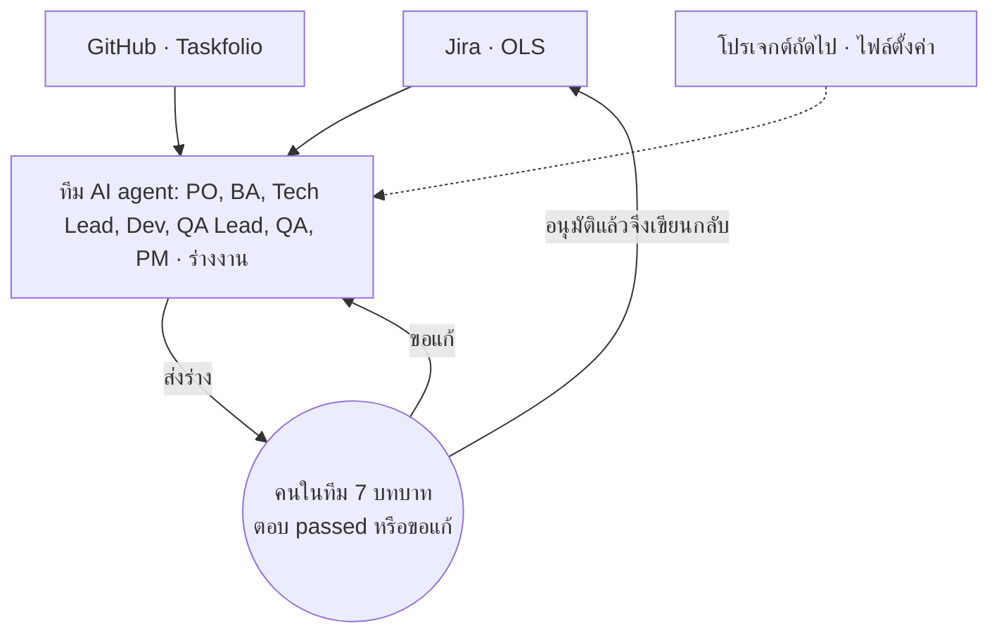
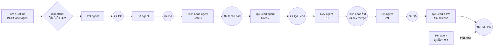

# แผนทีม AI Agent: รับงานจากหลายโปรเจกต์ใน Jira และ GitHub ร่วมกับ 7 ฝ่าย

> **สถานะ:** ร่างเพื่อคุยกับทีมก่อนเริ่มพัฒนา (draft for team review) · ยังไม่เริ่มสร้างตามแผนนี้ · เจ้าของแผน: @Thitic9203 ·
> ปรับครั้งล่าสุด 21 Oct 2026 (รอบสอง: รีวิวด้วยสกิล agent-designer แล้วเติมสถาปัตยกรรม สัญญาส่งต่อ เครื่องมือ สิทธิ์ งบ การวัดผล)
>
> **ที่มา:** เจ้าของ 21 Oct 2026 "ปรับแพลนในเรโป ต้องการโฟกัสการทำงาน AI Agent ที่รองรับงานจากหลายโปรเจ็คใน Jira, GitHub โดยผู้ร่วมงานจะมีหลายฝ่าย
> เช่น PO BA Tech Lead Dev QA Lead QA PM ... ปรับแพลนมาก่อน ยังไม่ต้องเริ่มทำ เราต้องเอาแพลนไปคุยกับทีม" · รอบสอง: "รีวิวและใส่รายละเอียดในแพลนให้ครบถ้วน
> พร้อมที่จะนำไปคุยกับทีมเพื่อเริ่มพัฒนา"
>
> **แผนนี้แทนอะไร:** เป็นแผนหลักของทิศทางใหม่ แผนเดิมยังเป็นบันทึกสิ่งที่สร้างแล้ว:
> [always-on-dev-agent](../superpowers/plans/always-on-dev-agent.md) (ตัว agent ฝั่ง GitHub ของ Taskfolio),
> [agent-workflow-and-economy](../superpowers/plans/agent-workflow-and-economy.md) (บทบาท สกิล รอบ release),
> แมพ [multi-project-intake](../wayfinder/multi-project-intake/MAP.md) (งาน QA ของ OLS) และแมพ
> [agent-all-roles](https://github.com/Thitic9203/pluton-timesheet/blob/main/docs/wayfinder/agent-all-roles/MAP.md) (PO/BA, DEV, QA จาก Jira)
>
> **ไฟล์ออกแบบ (สร้างด้วยเครื่องมือของสกิล agent-designer):** [agent-team-design/](agent-team-design/) มี `requirements.json` (ความต้องการที่ป้อน),
> `arch.json` (ผลวิเคราะห์สถาปัตยกรรม), `tool_descriptions.json` และ `tools_anthropic.json` (สคีมาเครื่องมือ 6 ตัว), `tools_validation.json` (ผลตรวจ:
> ทั้ง 6 ตัว `✓ Valid`)

---

## 0. ที่มาและความสำคัญ

> **หน้าสำหรับคุยกับทีม (มีภาพรวมและกระบวนการเป็นภาพ):** [แผนทีม AI Agent](https://claude.ai/artifact/9tWDnQzdMpv2QgBmWqq3qd)

**ที่มา:** งานของทีมกระจายอยู่หลายที่ ทั้ง ticket ใน Jira (เช่น OLS) และ issue ใน GitHub (เช่น Taskfolio) · งานร่างหลายอย่างทำซ้ำทุกใบ
เช่น เขียน AC, เทสเคส, test plan และสรุปสถานะ · ตัวอย่าง: OLS มี story ที่รอเติมรายละเอียดจาก PO/BA 6 ใบ (นับเมื่อ 20 Oct 2026, แมพ agent-all-roles A1)

**ความสำคัญ:**

- งานร่างที่ซ้ำ agent ทำให้เองทุกวันโดยไม่ต้องสั่ง คนเหลือแค่ตรวจและตัดสิน
- ทุกโปรเจกต์ทุกบทบาทใช้ทางเดียวกัน เพิ่มโปรเจกต์ใหม่ได้ด้วยไฟล์ตั้งค่าหนึ่งไฟล์
- ไม่มีอะไรเขียนลงระบบของทีมโดยไม่ผ่านคน และไม่มีค่าใช้จ่ายใหม่



## 1. เป้าหมาย (สิ่งที่ทีมจะได้)

1. ทีม agent รับงานเองจากหลายโปรเจกต์ ทั้ง **Jira** (เริ่มที่ OLS) และ **GitHub issue** (เริ่มที่ pluton-timesheet) โดยไม่ต้องมีคนสั่งทีละงาน
2. agent มี **7 บทบาท** คู่กับคนจริงในทีม: PO, BA, Tech Lead, Dev, QA Lead, QA, PM · agent ทำงานร่าง คนในบทบาทนั้นเป็นผู้ตัดสิน
3. ทุกการเขียนกลับระบบของทีม (Jira, GitHub, Sheet) **ผ่านการอนุมัติของคน** ก่อนเสมอ
4. เพิ่มโปรเจกต์ใหม่ได้ด้วย **ไฟล์ตั้งค่าหนึ่งไฟล์** ไม่ต้องแก้โค้ด
5. ไม่มีค่าใช้จ่ายใหม่ ถ้าไม่ได้อนุมัติเป็นรายกรณี (กฎ global ข้อ 3)

**นอกขอบเขต:** agent ข้ามหรือลดจุดอนุมัติของคน · agent deploy production เอง · agent merge PR เข้า branch หลักของโปรเจกต์ที่ทีมอื่นดูแล

## 2. หลักการที่ไม่เปลี่ยน (ตัดสินแล้ว ไม่ต้องคุยซ้ำ)

| หลัก | ที่มา |
| :--- | :--- |
| agent **เริ่มงานเอง** ทุกวัน คนไม่ต้องสั่ง | เจ้าของ 20 Oct 2026 "Agent ทำเองอัตโนมัติทุกวัน ทุกครั้งไม่ต้องให้บอกนะ" |
| **จุดอนุมัติคงเดิม**: agent ร่าง คนอนุมัติ ก่อนเขียนกลับ | เจ้าของ popup 20 Oct 2026 "คงจุดอนุมัติเดิม" |
| agent รับเฉพาะงานที่ **ติด label `agent`** (Jira) หรือ `agent:ready` (GitHub) | A4, A5 ของแมพ agent-all-roles · Decisions Q1 ของแผน always-on |
| agent ไม่ deploy production เอง | แผน always-on "ไม่ทำใน pilot" |
| สเปกก่อนโค้ดทุกครั้ง (spec, plan, tasks) | CLAUDE.md hard constraint 22 |
| งาน Jira รันบน GitHub Actions ใน repo นี้ ยกเว้นขั้นที่ต้องเปิดเว็บใน VPN ของลูกค้า (รันบน Mac runner `ols-e2e`) | A3, A7 ของแมพ agent-all-roles |
| โค้ดของ agent อยู่ใน `pluton-ai-agent` แยกจากโค้ดของ product | เจ้าของ 20 Oct 2026, spec [repo-split](../sdd/repo-split/spec.md) |
| การประเมินขนาดงานทำร่วมกันทุกบทบาท ไม่ใช่ฝ่ายเดียว | เจ้าของ popup 20 Oct 2026 (A4) |

## 3. สถาปัตยกรรม

### 3.1 รูปแบบ: Supervisor ที่เป็นโค้ด + ขั้นตอนตามบทบาท

ป้อนความต้องการของแผนนี้ ([requirements.json](agent-team-design/requirements.json)) เข้า `agent_planner.py` ของสกิล agent-designer ได้รูปแบบ
`SUPERVISOR` ([arch.json](agent-team-design/arch.json)) ตรงกับที่ระบบเดิมใช้อยู่ (แผน always-on "ตรวจสถาปัตยกรรม 14 Oct": dispatcher เป็นผู้คุม)

- **Supervisor = dispatcher ที่เป็นโค้ดล้วน ไม่ใช่ LLM:** อ่านสถานะของงานจาก label และประวัติคอมเมนต์ แล้วเลือกว่าขั้นถัดไปคือบทบาทไหน ·
  จุดที่เครื่องมือเตือนว่า "ผู้คุมเป็นคอขวด" ไม่เกิด เพราะ dispatcher ไม่เรียกโมเดล
- **แต่ละบทบาท = agent หนึ่งตัวที่รันเป็นงานแยก** (หนึ่ง job ต่อหนึ่งขั้น) ได้ context ใหม่ทุกครั้ง อ่านเฉพาะสิ่งที่ขั้นก่อนส่งมา
- **คนอยู่ระหว่างทุกขั้น:** agent ส่งร่าง แล้วรอ `passed` จากคนในบทบาทนั้นก่อน dispatcher จะเปิดขั้นถัดไป
- **ปรับจากผลของเครื่องมือ:** เครื่องมือเสนอ specialist 3 ตัว (development, communication) แผนนี้แยกเป็น 7 บทบาทตามคนจริงในทีม เพราะคนอนุมัติ
  ต่างกันในแต่ละขั้น (judgment) · ที่เครื่องมือเสนอแต่ตั้งใจไม่ทำ: retry แบบ backoff อัตโนมัติ (ขัดกฎ global ข้อ 21 ที่ให้หาเหตุ ไม่ rerun)



### 3.2 ชั้นของระบบ

| ชั้น | ทำอะไร | อยู่ที่ไหน |
| :--- | :--- | :--- |
| ตัวรับงาน (intake) | อ่านงานที่ติด label จากทุกโปรเจกต์ตามไฟล์ตั้งค่า | GitHub Actions ตามตาราง + event จาก relay ของ pluton-timesheet |
| Dispatcher | ตัดสินขั้นถัดไป, เพดานงานพร้อมกัน, คิว | โค้ดใน `pluton-ai-agent` (`scripts/agent/dispatch.mjs` ต่อยอด) |
| Role agents | ร่างงานของแต่ละบทบาท | `claude-code-action` บน GitHub Actions / Mac runner สำหรับงานใน VPN |
| ประตูอนุมัติ | ส่งร่าง, อ่านคำตอบ `passed` | Slack DM (Jira) / คอมเมนต์ GitHub (Taskfolio) |
| ตัวเขียนกลับ | เขียนเฉพาะสิ่งที่อนุมัติ แล้วอ่านกลับตรวจ | โค้ดล้วน (ไม่ใช่ LLM) |
| การมองเห็น | สถานะ, เวลา, ค่าใช้จ่าย | Agent Office + สรุปของ PM agent |

## 4. บทบาท: agent ทำอะไร คนตัดสินอะไร

แต่ละบทบาทมี agent หนึ่งตัวต่อโปรเจกต์ (หรือมากกว่าเมื่อเพดานอนุญาต) และมี **คนในบทบาทนั้น** เป็นผู้อนุมัติ

| บทบาท | agent รับงานจาก | agent ทำ (ร่าง) | คนในบทบาทตัดสิน | ส่งต่อให้ |
| :--- | :--- | :--- | :--- | :--- |
| **PO** | งานใหม่ที่ติด label `agent` | จัดลำดับ backlog, ร่างเป้าหมายและ AC ระดับผลลัพธ์, ตอบคำถามขอบเขต | ลำดับงาน, ขอบเขต, ยอมรับผลรอบ release | BA |
| **BA** | งานที่ PO ส่งต่อ / Jira `Ticket Detail Status` = Pending Details, Pending PO Review, Awaiting PO Clarification | ร่าง AC ละเอียด, flow, กฎธุรกิจ, edge case, ลิสต์คำถามที่ไม่มีแหล่ง, เสนอ `Ticket Detail Status` ใหม่ | AC ครบหรือยัง | Tech Lead, Dev, QA Lead |
| **Tech Lead** | งานที่ AC ครบ / PR ที่เปิดใหม่ | ร่างแนวทางเทคนิคและความเสี่ยง, แตก subtask, รีวิว PR ด้วย `code-review` | แนวทางเทคนิค (Gate 1), อนุมัติ PR | Dev, QA Lead |
| **Dev** | งานที่ผ่าน Gate 1 และ Gate 2 | เขียนโค้ด test-first บน branch `agent/...` แล้วเปิด PR | (ไม่ตัดสินเอง) | Tech Lead |
| **QA Lead** | plan ที่ผ่าน Gate 1 / รอบ release | ร่าง test plan ผูก AC ทุกข้อ, รีวิวเทสเคสด้วย `tc-review`, สรุปผลรอบ release | test plan (Gate 2), ผ่านหรือไม่ผ่านของรอบ | QA, PM |
| **QA** | ใบ READY TO TEST / TESTING ที่ตัวเองเป็น QA Owner | เขียนเทสเคส, เทสด้วย `testing-ticket`, รีเทสด้วย `retest-bug`, ร่างผล | ผลเทส (`passed` ใน DM ก่อนเขียนกลับ) | QA Lead |
| **PM** | ภาพรวมทุกโปรเจกต์ (ไม่รับงานรายใบ) | ร่างสรุปสถานะรายวัน/รายสัปดาห์, ชี้งานที่ค้างนานหรือเสี่ยงเลยกำหนด, ร่างแผนรอบ release, ติดตามโควตาและค่าใช้จ่าย AI | ลำดับความสำคัญข้ามโปรเจกต์, วันที่ release | ทุกบทบาท |

> **PM เป็นบทบาทใหม่** ที่ยังไม่มีในแผนเดิม (เดิมมี "Head" ทำหน้าที่ใกล้เคียง) · หน้าที่ในตารางเป็น **ร่างให้ทีมคุย** (คำถาม Q1)

### 4.0 งาน QA: ใช้สกิล Helix ทุกด่าน คน QA อนุมัติสูงสุด

เจ้าของ 21 Oct 2026: "อยากให้เพิ่มในส่วนงาน QA ให้ครบว่าใช้สกิลทดสอบจาก helix ที่เราทำไว้ทั้งหมดในทุกขั้นตอน ... คือใช้ AI สกิลจาก Helix ทำเสมอ
แต่ก็ยังต้องมี คนคือ QA เป็นผู้อนุมัติสูงสุดในแต่ละด่าน"

| ด่าน | สกิล Helix | agent ทำ (ร่าง) | คน QA อนุมัติ |
| :--- | :--- | :--- | :--- |
| เตรียมข้อมูลทดสอบ | `/test-data-prep` | สร้างข้อมูลที่เคสต้องใช้บน environment ทดสอบ และบันทึก id | ข้อมูลถูกต้องและพอสำหรับเคส |
| ทำเทสเคส | `/tc-fe-prep` · `/tc-api-prep` | เขียนเทสเคสหน้าเว็บและ API จาก AC ทุกข้อ ลงชีท QA | เทสเคสครบตาม AC |
| รีวิวเทสเคส | `/tc-review` | ตรวจเทสเคสเทียบ AC, edge case, กฎธุรกิจ | เทสเคสพร้อมใช้เทส |
| เทส story และ task | `/testing-ticket` | เทสด้วย Playwright เทียบ design และร่างผลต่อเคส | ผลเทสก่อนเขียนกลับ Jira |
| รีเทส bug และ task | `/retest-bug` | รีเทสหลัง dev แก้ เก็บหลักฐาน ร่างคอมเมนต์และสถานะ | ผลรีเทสและสถานะใหม่ |
| เปิดบัค | `/create-bug` | ร่างบัคพร้อมหลักฐาน เฉพาะเมื่อผลต่างจากสเปกที่ยืนยันแล้ว (กฎ global ข้อ 10) ถ้าสเปกไม่ชัดเป็นคำถามถึง PO | บัคนี้เป็นบัคจริงและเปิดได้ |
| รีวิวผลการเทส | `/review-result` | ตรวจหลักฐานและผลที่บันทึกว่าครบและสอดคล้อง | ผลเทสพร้อมส่ง QA Lead |
| smoke หลัง deploy | `/smoke-test` | เทสฟีเจอร์หลักหลังขึ้นแต่ละ environment แล้วสรุปผล | build นี้ไปต่อได้ |
| ตรวจงานตัวเองก่อนรายงาน | `/catch-ai` | ตรวจว่าทุกข้อที่รายงานมีแหล่งยืนยัน | (ทำก่อนส่งทุกร่าง) |

ลำดับปกติของใบหนึ่ง: เตรียมข้อมูล → ทำเทสเคส → รีวิวเทสเคส → เทส (story/task) หรือรีเทส (bug/task) → เปิดบัคถ้ามี → รีวิวผล → ส่ง QA Lead ·
ทุกลูกศรคือจุดที่คน QA ตอบ `passed` หรือขอแก้ · agent ไม่ทำงาน QA นอกสกิล Helix

### 4.1 RACI ต่อขั้น (R = agent ทำ, A = คนอนุมัติ, C = ถูกปรึกษา, I = ได้รับแจ้ง)

| ขั้น | PO | BA | Tech Lead | Dev | QA Lead | QA | PM |
| :--- | :---: | :---: | :---: | :---: | :---: | :---: | :---: |
| คัดเข้า backlog และจัดลำดับ | R/A | C | C | I | I | I | C |
| AC, flow, คำถาม | A | R | C | C | C | C | I |
| ประเมินขนาด (ร่วมกัน) | C | R | R | R | R | R | A |
| แนวทางเทคนิค (Gate 1) | I | C | R/A | C | C | I | I |
| test plan (Gate 2) | I | C | C | I | R/A | C | I |
| เขียนโค้ดและ PR | I | I | A | R | I | I | I |
| เทสและผลเทส | I | I | I | C | C | R/A | I |
| สรุปรอบ release และวัน release | A | I | C | I | R | C | R |

## 5. สัญญาการส่งต่อ (handoff contract) ต่อขั้น

ทุกขั้นส่งต่อด้วย "แพ็กเกจ" รูปแบบเดียวกัน เก็บเป็นคอมเมนต์ที่มี marker บนตัวงาน (แบบเดียวกับ plan comment ของแผน always-on) และไฟล์บน branch

| ขั้น | รับเข้า | ส่งออก (ต้องมีครบ) | เสร็จเมื่อ | ไม่ผ่านเมื่อ |
| :--- | :--- | :--- | :--- | :--- |
| PO | ตัวงาน + backlog | ลำดับ, เป้าหมาย, AC ระดับผลลัพธ์, ขอบเขตที่ไม่ทำ | คน PO ตอบ `passed` | ขอบเขตไม่มีแหล่งอ้าง |
| BA | แพ็กเกจ PO + ลิงก์ design/เอกสาร | AC ทีละข้อพร้อมแหล่ง, flow, edge case, คำถามที่ไม่มีแหล่ง, `Ticket Detail Status` ที่เสนอ | คน BA ตอบ `passed` และคำถามค้าง = 0 | มีข้อใดไม่มีแหล่งแต่ไม่เป็นคำถาม |
| ขนาดงาน | แพ็กเกจ BA | ขนาดจากทุกบทบาท + ขนาดรวม (สูตรตาม Q6) | คน PM อนุมัติ | บทบาทใดไม่ให้ขนาด |
| Tech Lead (Gate 1) | แพ็กเกจ BA | ไฟล์ที่แตะ, แนวทาง, ทางเลือกที่ชั่ง, ความเสี่ยง, subtask | คน Tech Lead ตอบ `passed` | ไม่มีทางเลือกที่ชั่ง |
| QA Lead (Gate 2) | แพ็กเกจ Gate 1 | test plan ผูก AC ทุกข้อ (unit, API, E2E) | คน QA Lead ตอบ `passed` | AC ใดไม่มีเคส |
| Dev | Gate 1 + Gate 2 | branch `agent/<key>`, เทสต์ที่ fail ก่อนแล้วผ่าน, PR | CI เขียว + Tech Lead รีวิวผ่าน | CI แดง หรือเทสต์ไม่ผูก AC |
| QA | PR ที่ merge แล้วบน dev/staging | ผลต่อเคส, หลักฐาน, ร่างคอมเมนต์และสถานะ | คน QA ตอบ `passed` แล้วเขียนกลับสำเร็จ | FAILED ที่ไม่มีแหล่งยืนยัน (ต้องเป็นคำถามถึง PO) |
| Release | ผลเทสของทุกใบในรอบ | สรุปรอบ, ใบที่ผ่าน/ไม่ผ่าน, แผนวัน release | คน PM/PO ตัดสินวัน | มีใบที่ไม่ผ่านในรอบ |

## 6. เครื่องมือและสิทธิ์ของ agent

สคีมาเครื่องมือ 6 ตัวผ่านการตรวจของ `tool_schema_generator.py --validate` ครบ (`✓ Valid` ทุกตัว,
[tools_validation.json](agent-team-design/tools_validation.json)) · สคีมาแบบ Anthropic อยู่ที่ [tools_anthropic.json](agent-team-design/tools_anthropic.json)

| เครื่องมือ | ทำอะไร | เขียนข้อมูลไหม | ใครเรียกได้ |
| :--- | :--- | :--- | :--- |
| `intake_list` | รายการงานที่ติด label ของบทบาทหนึ่งในโปรเจกต์หนึ่ง | ไม่ (อ่านอย่างเดียว) | Dispatcher, PM |
| `item_read` | อ่านตัวงานเต็ม: description, AC, comment, ประวัติ, ลิงก์ | ไม่ | ทุกบทบาท |
| `draft_submit` | ส่งร่างและ action ที่เสนอให้คนอนุมัติของบทบาทนั้นใน DM | ส่งข้อความ DM เท่านั้น | ทุกบทบาท |
| `approval_read` | อ่านว่าคนอนุมัติตอบ `passed` หลังร่างล่าสุดหรือยัง | ไม่ | Dispatcher |
| `writeback_apply` | เขียนเฉพาะ action ที่อนุมัติ แล้วอ่านกลับทุกรายการ | ใช่ หลัง `passed` เท่านั้น | โค้ดเท่านั้น (ไม่ใช่ LLM) |
| `pr_open` | เปิด PR จาก branch `agent/<key>` | ใช่ (สร้าง PR) | Dev หลัง Gate 1 และ Gate 2 |

**กฎสิทธิ์:** agent ที่เป็น LLM ไม่ถือ token ที่เขียน Jira, Sheet หรือ GitHub ได้โดยตรง · การเขียนจริงทำโดย `writeback_apply` ซึ่งเป็นโค้ด
(แบบเดียวกับ `tick.mjs` ของ OLS ที่เป็นตัวเขียนเพียงตัวเดียว, R107) · ทุก token ขอสิทธิ์เฉพาะที่ job นั้นใช้ (`permission-*`, Decision Q3)

## 7. ไฟล์ตั้งค่าต่อโปรเจกต์

หนึ่งโปรเจกต์ใช้ไฟล์ตั้งค่าหนึ่งไฟล์ ต่อยอดจากหกช่องที่ตัดสินแล้ว (multi-project-intake P6) แล้วเพิ่มคนอนุมัติและช่องทางอนุมัติ

| ช่อง | Taskfolio (GitHub) | OLS (Jira) |
| :--- | :--- | :--- |
| แหล่งงาน | `Thitic9203/pluton-timesheet` label `agent:*` | `skilllane.atlassian.net` project `OLS` label `agent` |
| กฎรับงานต่อบทบาท | ตามแผน always-on | BA: `cf[12127]` 3 ค่า · Dev: `Details Provided` หรือ Bug/Task · QA: QA Owner `cf[12120]` |
| repo โค้ด | `pluton-timesheet` | `SkillLane/ols-monorepo` (A2) |
| ที่รัน | GitHub Actions | GitHub Actions + Mac runner `ols-e2e` สำหรับขั้นที่ต้องผ่าน VPN (A7) |
| คนอนุมัติต่อบทบาท | เจ้าของ | (คำถาม Q2) |
| ช่องทางอนุมัติ | คอมเมนต์ GitHub `/approve-plan` ฯลฯ | Slack DM เธรดต่อ ticket ตอบ `passed` (A5) |
| สกิลต่อชนิดงาน | ตารางสกิลต่อตำแหน่ง | สกิลในเรโป ols-qa |
| เพดานงานพร้อมกัน | 3 ใบ | 3 ใบ (แยกต่อโปรเจกต์, P6) |

ตัวอย่างรูปไฟล์ (ร่าง ยังไม่มีในโค้ด):

```yaml
project: OLS
source: { kind: jira, site: skilllane.atlassian.net, key: OLS, label: agent }
code_repo: SkillLane/ols-monorepo
runs_on: { default: github, vpn_steps: mac-ols-e2e }
roles:
  ba:  { intake: 'issuetype = Story AND cf[12127] in ("Pending Details","Pending PO Review","Awaiting PO Clarification")', approver: "<Q2>", channel: slack_dm }
  dev: { intake: '(issuetype = Story AND cf[12127] = "Details Provided") OR issuetype in (Bug, Task)', approver: "<Q2>", channel: slack_dm }
  qa:  { intake: 'cf[12120] = currentUser()', approver: "<Q2>", channel: slack_dm }
limits: { concurrent: 3 }
skills: ols-qa
```

## 8. งบ เพดาน และการจัดการเมื่อพัง

### 8.1 งบและเพดาน (ค่าที่เสนอ ให้ทีมตัดสิน: คำถาม Q8)

| เรื่อง | วันนี้ | เสนอ |
| :--- | :--- | :--- |
| งานพร้อมกันต่อโปรเจกต์ | 3 ใบ (Decision Q2) | คงเดิม จนวัดผล pilot ได้ |
| เวลาต่อหนึ่ง job | agent 120 นาที, review 30 นาที (แผน always-on R5) | คงเดิม |
| จำนวน turn ต่อ job | ไม่จำกัด (ไม่มี `--max-turns`, R83) | กำหนดต่อบทบาท (judgment: ตัวเลขจาก pilot) |
| รอบ revise ต่องาน | ไม่จำกัด (R83) | เพดานต่อวันต่องาน (judgment) |
| ค่าใช้จ่าย | $0 นอกบัญชี Max เดิม (R80) | คงเดิม · PR ใน repo ของ org ต้องได้ตัวเลขโควตาก่อน (Q5) |

### 8.2 เมื่อพัง

| อาการ | agent ทำอะไร | ใครรู้ |
| :--- | :--- | :--- |
| โค้ดของ agent เองทำเทสต์แดง | หาสาเหตุแล้วแก้ ห้าม rerun ให้เขียว ห้าม skip (กฎ global ข้อ 7, 18, 21) | Tech Lead |
| ปัญหานอกโค้ด (usage หมด, นาที Actions หมด, credential, GitHub/Jira ล่ม) | ติดสถานะ blocked พร้อม error จริง แล้วหยุด | PM + เจ้าของทาง DM |
| คนไม่ตอบร่าง | ไม่ทำต่อ, PM ชี้ในสรุปว่าค้างนานเท่าไร | PM |
| ตัวงานเปลี่ยนหลังส่งร่าง | `writeback_apply` ปฏิเสธ แล้วกลับไปร่างใหม่ | บทบาทนั้น |
| ร่างมีเนื้อที่ Slack แสดงไม่ได้ | กรองก่อนส่ง (ols-real R21) | บทบาทนั้น |

## 9. การวัดผลและเกณฑ์ผ่าน pilot

ใช้ `agent_evaluator.py` ของสกิล agent-designer กับ log การรันจริงของ pilot (ยังไม่มี log จึงยังไม่ได้รัน)

| ตัววัด | นิยาม | เกณฑ์ผ่าน pilot |
| :--- | :--- | :--- |
| งานเดินครบ | ใบที่ไปถึงขั้นสุดท้ายของบทบาท / ใบที่รับเข้า | ทุกบทบาทอย่างน้อย 1 ใบ |
| ร่างผ่านรอบแรก | ร่างที่ได้ `passed` โดยไม่ต้อง revise / ร่างทั้งหมด | วัดค่าตั้งต้น (ยังไม่ตั้งเกณฑ์) |
| เวลารอคน | เวลาจากส่งร่างถึง `passed` | วัดค่าตั้งต้น |
| เวลาของ agent ต่อขั้น | เวลาของ job | ไม่เกินเพดานในข้อ 8.1 |
| การเขียนข้ามคน | การเขียนกลับที่ไม่มี `passed` ก่อน | **0 เสมอ** |
| ปัญหาวิกฤต | `CRITICAL: N critical issues` ของ evaluator | **0** |
| ค่าใช้จ่ายใหม่ | บิลใหม่นอก Max และโควตาฟรี | **$0** |

## 10. สิ่งที่มีอยู่แล้ว (วันนี้)

| ส่วน | สถานะ | หลักฐาน |
| :--- | :--- | :--- |
| repo `pluton-ai-agent` (private) + โค้ด agent ย้ายมาแล้ว | ✅ ยังไม่เปิด Actions | main `658b87c`, เทสต์ 527/527 |
| App `taskfolio-dev-agent` บน `pluton-timesheet` และ `pluton-ai-agent` | ✅ | หน้า installations "Selected 2 repositories" (21 Oct 2026) |
| PO/BA triage และ sweep รายวันของ Taskfolio | ✅ รันอยู่ใน pluton-timesheet | `AGENT_TRIAGE_ENABLED`, `AGENT_SWEEP_ENABLED` = true |
| QA ของ OLS (เขียนเทสเคส, เทส, รีเทส) | 🟡 โค้ดมีแล้ว ยังไม่รันรายวัน | branch `feat/ols-retest-procedure-guards` |
| ย้าย secret ไป repo ใหม่ | 🟡 workflow ร่างแล้ว รีวิวขอแก้ 1 ข้อ | `feat/agent-secrets-copy` `3412f44af` |
| BA / Tech Lead / Dev / QA Lead / PM จาก Jira | ⬜ ตัดสินแล้วบางส่วน (A4, A5) ยังไม่สร้าง | แมพ agent-all-roles A9 |

## 11. ขั้นตอนพัฒนาที่เสนอ (เริ่มเมื่อทีมตกลง)

ทุกขั้นทำตาม SDD (spec, plan, tasks ก่อนโค้ด) และขึ้น staging ก่อนเสมอ

| ขั้น | ทำอะไร | เสร็จเมื่อ | ต้องได้ก่อน |
| :---: | :--- | :--- | :--- |
| 0 | ทีมตกลงแผนนี้และตอบคำถามข้อ 12 | คำตอบทุกข้อบันทึกในแผน | ประชุมทีม |
| 1 | ปิดงานแยก repo: คัดลอก secret, ทดลองรันจาก repo ใหม่, ปิด agent ฝั่งเดิม | triage และ sweep รันจาก pluton-ai-agent | ขั้น 0 |
| 2 | ไฟล์ตั้งค่าต่อโปรเจกต์ (ข้อ 7) + ตัวรับงาน Jira ร่วม GitHub + เครื่องมือ 6 ตัว (ข้อ 6) | Taskfolio และ OLS อยู่ในรูปไฟล์เดียวกัน, เทสต์ของเครื่องมือผ่าน | ขั้น 1 |
| 3 | ประตูอนุมัติหลายคน: approver ต่อบทบาท, `draft_submit`, `approval_read` | คนสองคนต่างบทบาทอนุมัติคนละขั้นได้ | Q2, Q3 |
| 4 | QA ของ OLS รันรายวัน | 1 ใบเดินครบถึงเขียนกลับ Jira หลัง `passed` | ขั้น 2, 3 |
| 5 | PO + BA ของ OLS (AC, คำถาม, ขนาดร่วม) | 1 story ถึง Details Provided หลังคนอนุมัติ | Q4, Q6 |
| 6 | Tech Lead + QA Lead (Gate 1, Gate 2) + Dev ถึง PR ใน ols-monorepo | 1 PR ที่ทีม dev ของ OLS รีวิวได้ | Q5 |
| 7 | PM: สรุปสถานะรายวัน/รายสัปดาห์ + สรุปรอบ release | สรุปสัปดาห์แรกส่งให้ทีม | Q1 |
| 8 | ประเมิน pilot ด้วย evaluator (ข้อ 9) | ผ่านเกณฑ์ข้อ 9 ครบ | ขั้น 4 ถึง 7 |
| 9 | โปรเจกต์ที่สาม | เพิ่มด้วยไฟล์ตั้งค่าอย่างเดียว | Q7 |

## 12. คำถามให้ทีมตัดสิน

| # | คำถาม | ทำไมต้องถาม | กระทบขั้น |
| :---: | :--- | :--- | :---: |
| Q1 | หน้าที่ของ **PM agent** ตามข้อ 4 ถูกไหม ขาดหรือเกินอะไร | บทบาทใหม่ ยังไม่มีสเปก | 7 |
| Q2 | ต่อโปรเจกต์ **ใครเป็นคนอนุมัติ** ของแต่ละบทบาท | ตอนนี้มีแค่เจ้าของคนเดียวอนุมัติทุกจุด | 3 |
| Q3 | ช่องทางอนุมัติของแต่ละคน: Slack DM, คอมเมนต์ใน Jira หรือ GitHub | DM ใช้ได้กับเจ้าของแล้ว ยังไม่เคยใช้กับคนอื่น | 3 |
| Q4 | ใครสร้าง label `agent` ใน Jira ของแต่ละโปรเจกต์ และใครมีสิทธิ์ติด | เป็นการสร้างของในระบบที่ทีมใช้ร่วม (กฎ global ข้อ 23) | 5 |
| Q5 | org `SkillLane` ติดตั้ง App ให้ `ols-monorepo` ได้ไหม และนาที Actions / spending limit ของ org เท่าไร | PR ของ agent ใช้โควตาของ org (A2, A8) | 6 |
| Q6 | รวมขนาดงานจากหลายบทบาทเป็นขนาดเดียวอย่างไร (เฉลี่ย, ค่ามากสุด, หรือสูตร size marker เดิม) | ตัดสินแล้วว่าทำร่วมกัน แต่ยังไม่มีสูตร | 5 |
| Q7 | โปรเจกต์ถัดไปคืออะไร และ site `humanintelligence` ต้องเปิดสิทธิ์ให้ agent อ่านไหม | A1: งานที่เปิดอยู่ของเจ้าของมีแค่ OLS | 9 |
| Q8 | เพดานงานพร้อมกัน, turn ต่อ job, รอบ revise ต่อวัน (ข้อ 8.1) | บัญชี Max เดียวรับทุกงาน (R83) | 2 |
| Q9 | งานที่ต้องเปิดเว็บใน VPN ของลูกค้าคงบน Mac ได้ไหม (Mac ต้องเปิดและต่อ VPN) | A7: GitHub runner เข้าไม่ถึง | 4 |
| Q10 | PM สรุปสถานะส่งที่ไหน (Slack channel ไหน, ความถี่) | ยังไม่มีช่องทางของทีม | 7 |

## 13. ความเสี่ยงและค่าใช้จ่าย

| ความเสี่ยง | โอกาส | ผลกระทบ | วิธีกัน |
| :--- | :---: | :---: | :--- |
| agent เขียนกลับโดยไม่ผ่านคน | ต่ำ | สูง | LLM ไม่ถือ token ที่เขียนได้, `writeback_apply` เป็นโค้ดและต้องมี `passed`, ตัวตรวจในเทสต์ |
| เนื้อหาในตัวงานสั่ง agent ให้ทำนอกงาน (prompt injection) | กลาง | กลาง | อ่านเนื้อหาเป็นข้อมูลเสมอ, worker ไม่มี MCP หรือ WebFetch (R107), ทุกผลเป็นร่าง |
| usage ของบัญชี Max หมด | กลาง | กลาง | เพดานข้อ 8.1, PM ติดตาม (Q8, R83) |
| นาที Actions ของ org เกินแล้วเสียเงิน | ไม่รู้ | กลาง | ได้ตัวเลขก่อนขั้น 6 (Q5) |
| credential ใหม่ (Jira, Slack) รั่ว | ต่ำ | สูง | เก็บเป็น secret ของ repo นี้เท่านั้น, ลง RISK_REGISTER ก่อนเปิด |
| คนไม่ตอบร่าง งานค้าง | กลาง | ต่ำ | PM ชี้งานค้างในสรุป |
| งานใน VPN รันไม่ได้เมื่อ Mac ปิด | สูง | ต่ำ | เฉพาะขั้นเทสบน dev, ขั้นอื่นรันบน GitHub (Q9) |

**ค่าใช้จ่าย:** ใช้บัญชี Claude Max เดิม (R80) และนาที GitHub Actions ฟรีของ repo ส่วนตัว · PR ใน repo ของ org ใช้โควตาของ org (Q5) ·
ไม่มีบริการเสียเงินใหม่
